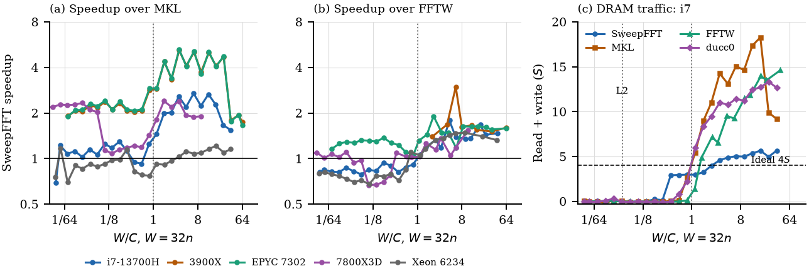
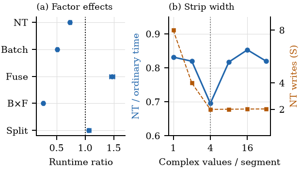

# SweepFFT

**SweepFFT: Pass-Minimal Algorithms for
Out-of-Cache Fast Fourier Transforms.**

Recent work proves integer multiplication and the DFT in O(n (log n)^{1-κ}) on a *multitape Turing
machine*:
- OpenAI's manuscript, *Integer multiplication below n log n* (openai/math);
- the follow-up [CrocSwap/integer-mult-bounds](https://github.com/CrocSwap/integer-mult-bounds).

The gain itself, is unmeasurable at any size that fits in RAM. But the cost model the
proofs optimise, *passes over a tape*, maps closely onto *sweeps through DRAM*, and that is what limits
large FFTs.

At the largest transform length
common to all systems, **SweepFFT is 1.15–1.96× faster than MKL
and 1.27–3.52× faster than FFTW under the headline protocol**.
The advantage depends on cache footprint, factorization, plan-
ning and paging. A factorial ablation on one system attributes
94.5–99.6% of explained out-of-cache log-runtime variation to
batching, fusion, their interaction, and non-temporal stores.

[Preprint link](https://doi.org/10.5281/zenodo.23322613).

Full write-up: [`results/REPORT.md`](results/REPORT.md).

## Final results

### Five machines: pre-registered endpoints

Each machine ran the full suite (`scripts/run_machine.sh <label> --all`) with the final code, including
both pre-registered studies from [results/ENDPOINTS.md](results/ENDPOINTS.md). Each study has 10 blocks of
fresh pinned processes, uses the geometric mean over 2^22 – 2^26, and reports 95% block-bootstrap intervals.
Every primary endpoint below favours pmfft with p_Holm = 0.002. *Ordinary* means caller arrays allocated
the ordinary way (the primary study); *huge* means caller arrays on 2 MB pages.

| machine | vs FFTW, ordinary | vs FFTW, huge | vs MKL, ordinary | vs MKL, huge | large non-powers of two vs MKL |
|---|---|---|---|---|---|
| Intel i7-13700H (laptop) | **1.18** [1.16, 1.20] | 1.45 | **1.03** [1.02, 1.04] | 1.13 | 2.29 |
| Intel Xeon Gold 6234 (server, Cascade Lake) | **1.23** [1.20, 1.25] | 1.39 | **1.18** [1.15, 1.20] | 1.19 | 1.20 |
| AMD EPYC 7302 (server, Zen 2) | **1.32** [1.30, 1.34] | 1.56 | **1.17** [1.16, 1.18] | 1.65 | 1.97 |
| AMD Ryzen 9 3900X (desktop, Zen 2) | **1.31** [1.30, 1.31] | 1.60 | **1.22** [1.22, 1.22] | 1.74 | 2.00 |
| AMD Ryzen 7 7800X3D (desktop, Zen 4, 96 MB L3) | **1.23** [1.22, 1.24] | 1.45 | **1.28** [1.26, 1.30] | 1.15 | 2.08 |

- **Where pmfft loses:** in cache (2^4 – 2^11), FFTW is faster at most sizes on every machine.
- **The paging effect varies by machine** ([REPORT §20–21](results/REPORT.md)). It is strongest on Zen 2, small on the Xeon, and
  reversed for MKL on the 7800X3D.
- **No overlap on one core, on any machine.** Data movement and arithmetic add up rather than overlap:
  their sum is 0.88 – 1.00 of the full time everywhere ([REPORT §22](results/REPORT.md)).

### Where the advantage starts: the cache transition



*Fig. 1. SweepFFT's speedup over MKL (a) and FFTW (b) on all five machines, against W/C. W = 32n is the size
of input plus output, and C is the local last-level cache. The curves are half-octave geometric means over 97
smooth sizes. The lead appears once the data no longer fit in the cache (W/C > 1). (c) DRAM traffic per
transform on the i7, in sweeps S = 16n bytes, from calibrated memory-controller counters. The dashed line is
the two-pass ideal of 4 S. Beyond the cache, SweepFFT stays near that ideal while the libraries move 2–3× more
bytes.*

### What makes it fast: the factorial ablation



*Fig. 2. Factorial ablation on the i7-13700H at 2^22. (a) Effect of each design choice on runtime, with 95%
intervals: non-temporal stores (NT), batched strips (Batch), fused passes (Fuse), their interaction (B×F, a
ratio of ratios; 1 would mean independence) and the split shape (Split). (b) Non-temporal over ordinary
stores, in runtime and write traffic, against strip width. Non-temporal stores pay off once each segment
covers a full cache line (four complex values).*

## Run the benchmark on your machine

Requirements:
- Linux on x86-64 with **AVX2 + FMA** (Intel Haswell or later, AMD Zen or later);
- gcc/g++ ≥ 11, make, curl, git, python3, and [uv](https://docs.astral.sh/uv/);
- about 2 GB of disk;
- 16 GB or more of RAM for the largest size (2^26 needs about 8.5 GB per process while planning;
  smaller machines automatically stop at a smaller size).

```bash
git clone https://github.com/dzako/sweepfft && cd sweepfft
uv sync                                   # Python env (pandas, numpy, ...) for the scripts
scripts/setup_third_party.sh              # download + build FFTW 3.3.10, MKL 2024.2.2 (wheels), ducc0 (~5 min)
scripts/build.sh                          # build all benchmarks into build/
scripts/run_machine.sh my-box --quick     # 5-minute smoke test -> results/machines/my-box-quick/
scripts/run_machine.sh <label>            # full run (45-90 min)  -> results/machines/<label>/
scripts/run_machine.sh <label> --all      # every study below (~12-20 h)
```

### What the full run measures

Unless `--mt` is given, everything runs single-core, using the same protocol as the report:
- powers of two from 2^4 to 2^26;
- smooth composite sizes;
- primes, in both exact mode and `fast=1`;
- the 3-sweep convolution;
- a multi-process bandwidth-scaling test with k = 1, 2, 4, 8, … processes, up to the number of
  physical cores on socket 0.

Add `--mt` for the **multithreaded comparison**. It runs `pmfft_mt` against threaded MKL and threaded
FFTW in one process, with 1, 2, 4, … threads up to the number of physical cores on socket 0 (on hybrid Intel CPUs that includes the E-cores), and with
DRAM traffic at the full thread count when the counters are enabled. FFTW plans every (threads, n) for up
to `FFTW_TIMELIMIT_MT` seconds (default 300), so `--mt` adds roughly 1 – 3 hours; many-core servers are
at the long end. It needs `build/bench_dft_mt`, which `scripts/build.sh` builds once
`setup_third_party.sh` has built FFTW with OpenMP. To run it alone:
`uv run scripts/scale_mt.py --quick` (smoke test) or `uv run scripts/scale_mt.py --sizes 2^22,2^24`.
On laptops, keep the machine plugged in and cool. Sustained all-core load triggers power limits that
move the results by 10 – 20%.

Add `--cache-transition` for the dense sweep of 97 smooth sizes across the L2, LLC and 2 – 8 × LLC
boundaries (about 1 hour; adds a phase-diagram figure), and `--factorial` for the full 2^4 factorial ablation of
NT stores × batching × fused transposes × split policy with an interaction model on log runtime (about
1 hour). Both use the DRAM counters when they are enabled.

Five further options test whether the results are robust and useful:
- `--fairness` (~3–4 h): protocol sensitivity. It covers in-place, cold caches, fresh arrays, 4 KB or
  all-huge pages, FFTW ESTIMATE / MEASURE / PATIENT with and without wisdom, first-call timing, an
  x86-64-v3 build, and a matched-protocol comparison.
- `--repro` (~2–3 h): the reproducibility study with the endpoints fixed in advance in
  [results/ENDPOINTS.md](results/ENDPOINTS.md). It runs 10 blocks, keeps every sample, logs clock and
  temperature, and reports block-bootstrap intervals. It runs twice: with ordinarily allocated caller
  arrays (the primary study, `repro_plain.*`) and with caller arrays on huge pages (`repro.*`).
- `--caller-pages` (~40 min): how the paging of the caller's arrays changes every library (huge-page
  vs ordinary allocation, interleaved), plus the strided-gather microbenchmark that exposes L2 set
  aliasing (GB/s vs rows, segment size, page size, stride padding).
- `--overhead` (~45 min): planning and memory overhead. It reports total time for 1 to 10,000 transforms,
  break-even reuse counts, and the memory held after planning, the planning peak and the execution scratch.
- `--contention` (~2 h): controlled bandwidth contention, in two parts:
  - (A) 1 to all cores of independent processes, with DRAM traffic and clocks;
  - (B) one FFT beside a STREAM-triad load whose bandwidth is measured. On CPUs with several L3 domains,
    B runs both with the load sharing the FFT core's L3 and with the load sharing only DRAM.

`--ceiling` (~1 h) times the two-pass plan with its arithmetic removed, with its memory traffic removed,
and as two plain streaming passes. This shows how much of the time is data movement, how much is
arithmetic, and how much the two overlap. It also maps the error budget of the Gaussian-resampling DFT for
large primes.

`--all` turns on every optional study (`--ablations --mt --factorial --cache-transition --fairness
--repro --overhead --contention --caller-pages --ceiling`).

Add `--ablations` to re-check whether the key ideas carry over to your hardware: non-temporal stores,
batching, the four-step split shape, and explicit transposes.

**DRAM-traffic counters (recommended).** If system-wide perf counters are allowed, the run also measures
DRAM bytes per transform. Enable them before the run (no reboot needed; the setting reverts at reboot):

```bash
sudo sysctl kernel.perf_event_paranoid=0
```

Counter support:
- Intel: memory-controller (IMC) counters.
- AMD Zen 2/3: data-fabric DRAM-channel counters, read + write combined. If
  `/sys/bus/event_source/devices` has no `amd_df`, load the uncore driver first:
  `sudo modprobe amd_uncore`.
- WSL2 and most VMs: not available, so this step is skipped.

Pass `--no-counters` to skip it.

### Tips for clean numbers

- Close other applications.
- Use the `performance` governor where you can: `sudo cpupower frequency-set -g performance`.
- Leave transparent huge pages at `madvise` or `always`.
- **Choosing cores.** Single-core runs are pinned to the fastest physical core: on hybrid Intel parts
  that is a P-core, and CPU 0 is avoided. The scaling test uses one logical CPU per physical core of
  socket 0, so on multi-socket servers it stays on one memory controller. To override:
  `BENCH_CPU=<cpu>` and `BENCH_CPUS=<a,b,c,...>`.
- **AMD CPUs.** MKL is Intel's library and may not use its best code paths on AMD. The comparison
  against FFTW, which is built here with `-march=native` for your CPU, is the vendor-neutral one.
- **FFTW planning time.** FFTW_MEASURE planning is capped at `FFTW_TIMELIMIT` seconds per size
  (default 60). On slower machines the large sizes can hit the cap, which yields a truncated, slow
  plan; `summary.md` flags those sizes. For a fair comparison there:
  - delete `results/machines/<label>/fftw_wisdom.dat`;
  - rerun with `FFTW_TIMELIMIT=600 scripts/run_machine.sh <label>`. This adds up to about 10 min of
    planning per affected size.
- **Virtual machines and WSL2.** CPU pinning targets virtual CPUs and the host schedules them, so expect
  more noise. Note it in the label, for example `ryzen-3900x-wsl`.

### Contributing results

After a full run, `results/machines/<label>/` contains:
- the raw CSVs;
- `machine.txt`, with lscpu, kernel, compiler, governor and memory size (no hostname or user data);
- `summary.md`;
- logs;
- the FFTW wisdom used.

`results/machines/COMPARISON.md` puts all machines side by side. Commit the directory together with
the regenerated `COMPARISON.md` and open a pull request:

```bash
uv run scripts/compare_machines.py
git add results/machines/<label> results/machines/COMPARISON.md
```

## Reproducing the full study

`scripts/run_all.sh` reruns all ablations, the final comparisons, the Toeplitz tests (T1–T3) and the
analysis on the reference layout `results/*.csv`. It takes about 70 minutes. `uv run scripts/analyze.py`
regenerates `results/tables.md` and the figures.

## Layout

```
csrc/common/common.h         aligned / huge-page allocation, timers, AVX2 complex helpers, accurate twiddles
csrc/ref/ref.h               __float128 reference DFT (error measurement)
csrc/dft/stockham.h          batched mixed-radix Stockham engine, fused radix-2^f passes      [I2, I9]
csrc/dft/rec4.h              recursive batched four-step, fused transposes, NT stores         [I1, I3, I4, I5, I11]
csrc/dft/rdit.h              depth-first recursive DIT for mid sizes
csrc/dft/arbitrary.h         Bluestein, Rader, Gaussian-resampling DFT                        [I7]
csrc/bench/impl_ours.c       all our variants + pmfft (the measuring planner), pmfft_heur, pmfft_mt
csrc/bench/impl_ext.c        FFTW / MKL wrappers;  impl_ducc.cpp: ducc0 wrapper
csrc/bench/bench_dft.c       driver -> CSV (time, GFlop/s = 5 n log2 n / t, error vs quad reference)
csrc/bench/bench_conv.c      cyclic convolution: library vs 3-sweep transposed-spectrum fusion [I9]
csrc/bench/bench_2d.c        2-D: Nussbaumer polynomial transform vs row-column               [I8]
csrc/tests/                  codelet/engine tests, transpose & axis-permutation benchmarks     [I1-toy, I14]
tests/test_toeplitz.py       Toeplitz representation tests T1-T3
scripts/                     setup_third_party.sh, build.sh, run_machine.sh, run_all.sh, run_bench.py,
                             scale_mp.py, scale_mt.py, mem_traffic.py, cache_transition.py (+ plot_cache_transition.py),
                             factorial.py, compare_machines.py, analyze.py, gen_codelets.py, cpus.py
results/                     reference-machine data, REPORT.md, tables.md, figures; machines/<label>/ per machine
```

## Citation

If you use SweepFFT or its results, please cite the paper
([doi:10.5281/zenodo.23322613](https://doi.org/10.5281/zenodo.23322613)):

```bibtex
@misc{cyranka2026sweepfft,
  author    = {Cyranka, Jacek},
  title     = {{SweepFFT}: Pass-Minimal Algorithms for Out-of-Cache Fast {Fourier} Transforms},
  year      = {2026},
  publisher = {Zenodo},
  note      = {Working paper, version 1},
  doi       = {10.5281/zenodo.23322613},
  url       = {https://doi.org/10.5281/zenodo.23322613}
}
```

## Licence

GPL-2.0-or-later (see `LICENSE`).

The benchmark links against the following libraries. `scripts/setup_third_party.sh` downloads them; they
are not distributed with this repository:
- FFTW (GPL-2.0-or-later);
- ducc0 (GPL-2.0-or-later);
- Intel MKL (Intel Simplified Software License).
