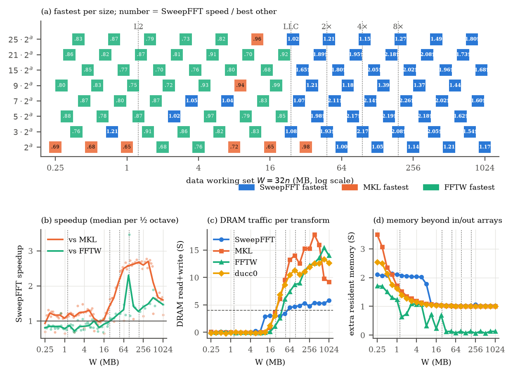
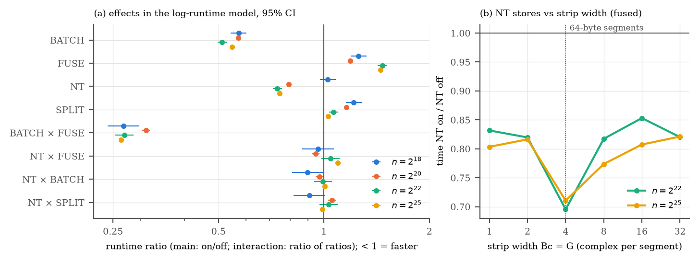

# From "integer multiplication below n log n" to a practical FFT: which ideas actually help?

*Clean run on 2026-10-08. Single P-core of an i7-13700H (AVX2/FMA, 48 KB L1d, 1.25 MB L2 per P-core,
24 MB L3), with desktop applications closed. Every timing is the median over 3 interleaved rounds
(2 rounds for the I7 grid) of per-run medians. Raw data is in `results/*.csv`, figures in
`results/fig_*.png`, and every table in `results/tables.md`.*

## 1. Context and framing

OpenAI's manuscript (openai/math @ adc7f124) and the CrocSwap/integer-mult-bounds PRs prove
T(n) = O(n (log n)^{1-κ}) on a **multitape Turing machine**. The best claimed κ was about 1.6e-5 (PR #33) when
this study started. It is 4.6e-4 on main as of 2026-10-09; see §7.

- **The asymptotic gain is unmeasurable.** At κ ≈ 1.6e-5, the factor (log n)^κ differs from 1 by less
  than 0.01% for any n that fits in RAM.
- **What these papers reduce is passes over a 1-D tape.** That is data movement, and data movement is
  also what bounds real FFTs once the data leaves cache.

We therefore treated every mechanism in the papers as a hypothesis about memory traffic or the shape of
the arithmetic circuit. Each one was implemented in isolation, measured against a common baseline, and
the winners were combined into **pmfft**, a measuring planner. pmfft was then compared with MKL 2024.2,
FFTW 3.3.10 (AVX2/FMA; MEASURE and PATIENT) and ducc0.

## 2. The real-hardware cost model we found (the bridge to the TM model)

A microbenchmark (`csrc/tests/gather_bw.c`) and a phase-level profile of the four-step algorithm
(`prof_rec4`) give this model:

| access pattern | bandwidth |
|---|---|
| strided read, 2048 rows × 128 B, power-of-two stride | 10.3 GB/s |
| same, row stride padded by 64 B | 18.7 GB/s (22.7 with prefetch) |
| strided read, ≤ 64 long streams | 22 GB/s |
| sequential copy (memcpy) | 20 GB/s |
| strided **non-temporal** writes (128 B segments) | 45 GB/s |

The tape-machine rules of thumb carry over almost literally:
- reads should be sequential, or use few long streams;
- writes may be strided, provided they are non-temporal ("write-only tape");
- power-of-two strides must be avoided wherever the layout is ours to choose.

Every positive result below is an instance of these rules.

## 3. Idea-by-idea verdicts

| ID | Idea (source) | Practical form | Verdict | Key numbers (GFlop/s = 5 n log2 n / t) |
|---|---|---|---|---|
| I2 | simultaneous butterfly layers on *f* address bits (upstream §5) | radix-2^f fused passes | **helps** | radix-8 vs radix-2: 50.3 vs 29.4 at n = 1024 (1.7×), 12.3 vs 4.7 at 2^22 (2.6×). Radix 16/32 spill AVX2 registers. |
| I10 | shared partial sums / CSE in fixed linear circuits (#2–#4, #6, #9) | generated codelets | **helps** | opt vs dense R×R: 2–10× faster (radix 8: 53.7 vs 18.9 at n = 256) and about 2× more accurate. Trivial-twiddle specialisation adds +3–6%. |
| I6 | one rounding per fused layer, semantic precision (#10, #16, #23) | radix choice vs accuracy | **small effect** | Radix 4 is the most accurate (2.83e-16 at 2^20). Large codelets with non-trivial constants are slightly worse (radix 32: 4.2e-16). |
| I3 | batch rank-1 sub-calls into one wide contiguous call (#10, #13–#17, #25, #31, #33) | batched strips in the four-step | **helps strongly** | Strip width 8 vs 1: 15.9 vs 5.6 at 2^22 and 14.7 vs 5.8 at 2^26 (2.5–2.8×). |
| I4 | two-stage, *smaller* inner dimensions (#29, #31, #33) | four-step split shape | **helps at ≥ 2^24** | Small inner N1: 15.3 vs 14.3 at 2^24. Balanced is best at ≤ 2^22. A large inner dimension always loses (9.6 vs 14.6 at 2^26). |
| I5 | rectangular / multi-level tensor shapes (#18, #28, #30, #32) | deeper recursion | **hurts** | Best is 2 levels with 2–16 MB leaves. A 4K-point budget (more levels) drops 2^26 to 8.6 from 14.7, because every level is another copy sweep. |
| — | "write-only tape" (implicit in the TM cost) | non-temporal stores | **helps** | +7% to +27% at ≥ 2^18 (2^20: 18.0 vs 14.3; 2^24: 14.3 vs 11.2). |
| I11 | dirty scratch, padded / reused banks (#4, #18, #19) | padded intermediate rows | **neutral in rec4** | rec4 reads its intermediate sequentially, so padding cannot help. Padding matters wherever an intermediate is read with a stride (used in I9). |
| I1 | address-field interchange as separate passes vs fused (§3–4) | six-step (explicit transposes) vs rec4 (fused) | **tie** | With NT transposes the six-step is within ±10% of fused rec4 (wins at 2^18–2^20, loses at 2^26: 13.7 vs 14.6). Explicit transposes *without* NT stores lose 15–30%. |
| I1-toy | interchange via shears D←D−H, H←H+D, D←H−D (upstream §4) | three-shear in-place transpose | **hurts** | 5.7–16 GB/s vs 44–89 GB/s for a blocked NT transpose (3–8× slower). Its only merit is O(N) scratch, and in-place tile swaps are faster still (8–17 GB/s). |
| I14 | non-adjacent routing, d² → d (CrocSwap) | one direct multi-axis permutation pass | **helps** | (a,b,c)→(c,b,a): direct 14.5–42 GB/s vs chain of adjacent swaps 7.6–14.4 GB/s (1.9–2.9×). Two grouped transposes sit in between. |
| I9 | never materialise permutations; keep implicit order (§6, §8) | convolution with the spectrum left in transposed order, pointwise multiply and inverse row-FFT fused: **3 sweeps** | **helps out of cache** | Speed vs MKL: **1.26× at 2^22** (55 vs 69 ms), **1.15× at 2^24** (277 vs 318 ms), 0.95× at 2^20, and 0.6–0.7× in cache. Error 8e-16 (MKL 6e-16). |
| I15 | CRT multi-axis cyclic convolution (§8) | Good–Thomas PFA | **hurts** | PFA vs mixed-radix Stockham: 24.4 vs 42.1 at n = 1536 and 8.4 vs 11.6 at 6.6M. The index-map gathers cost more than the twiddles they save. |
| I8 | Nussbaumer synthetic roots, twiddles as signed shifts (upstream pipeline) | polynomial-transform 2-D DFT | **hurts** | About 2× slower than row-column at every N from 64 to 2048 (1024²: 11.4 vs 25.0). It saves multiplies, which FMA hardware gives away almost for free, and adds a data pass per level. |
| I7 | HvdH Gaussian resampling, Bluestein form, Neumann series (#5, #23) | arbitrary-n DFT: resample to a smooth length t ≈ 1.4n, one FFT, deconvolve, 1 alias-correction iteration | **helps for large primes, at ≈ 1e-14 accuracy** | L=4, δ=0.4, 1 iteration: rel. error 3e-14. **1.12× MKL at n = 10^6+3 and 1.6× at 4·10^6+37.** About 1.75× faster than Bluestein at 16M. Exact-precision methods remain the choice when ≤ 1e-15 is required. |
| — | rank-deficient bank networks (s < W·m), F2/F3 designs | none | **not transferable** | They pay off only on a 1-D tape (W ~ 10^14–10^21, deficit about 1e-11). On a RAM a blocked transpose is already a single pass. |

### Toeplitz-representation tests (T1–T4, `tests/test_toeplitz.py`)

- **T1: all four structured identities hold to about 1e-39** at 40 digits:
  - Bluestein D·T·D;
  - the Rader circulant;
  - the HvdH resampling identity F_t G = A F_s on which our C code is built;
  - PR #5's completing-the-square identity (σa−b)² = σθa² + σ(a−b)² − θb² with θ = σ−1.
- **T2: in double precision, PR #5's chirp·Toeplitz·chirp form only works for tiny blocks.** The
  diagonal factors grow like 10^{βσ(1−σ)B²}:
  - B ≤ 8 gives about 1e-13 error;
  - B = 16 gives 1e-8 to 4e-4;
  - B ≥ 32 overflows.

  The practical form is the direct banded kernel. It uses the same identity at block size 1, which
  makes each tap weight O(1) to compute: exp(−βf²)·exp(2βf)^i·exp(−βi²).
- **T3: inverting the resampling.** G^T G is Toeplitz to within 1e-16 to 1e-10, and its condition
  number is about e^{2L}/2 (27, 1.5e3 and 6e5 for L = 2, 4, 7).
  - Plain Neumann/Richardson needs about 350 iterations at L = 2 and fails (5000 iterations) at L ≥ 4.
  - CG needs 68 to over 5000 iterations.
  - CG preconditioned with a Strang circulant converges in **1–7 iterations**.

  This is why the C implementation deconvolves in the frequency domain (the circulant step) and keeps
  only a 1-iteration Neumann correction for the aliasing.
- **T4:** this is the I7 row of the table above.

## 4. The combined algorithm: pmfft

pmfft is a measuring planner (like FFTW_MEASURE) over the winning components:
- **in cache:** Stockham autosort with radix 4/8/16 fused passes (I2), generated codelets (I10), and
  no bit-reversal pass (I9);
- **mid sizes:** an additional FFTW-style recursive out-of-place DIT;
- **out of cache:** the recursive batched four-step (I3, I4, NT stores, fused or explicit-NT
  transposes, I1);
- **non-smooth n:** Bluestein on the same engine (exact), or the Gaussian-resampling fast mode
  (I7, `fast=1`).

### Final comparison (GFlop/s, higher is better; all relative errors ≤ 4.3e-16 for exact modes)

| n | 2^8 | 2^12 | 2^16 | 2^18 | 2^20 | 2^22 | 2^24 | 2^26 |
|---|---|---|---|---|---|---|---|---|
| **pmfft** | 53.4 | 38.1 | 25.7 | 22.2 | 18.3 | **16.0** | **16.6** | **17.0** |
| MKL 2024.2 | 65.7 | 56.1 | 38.4 | 29.5 | 19.6 | 15.7 | 14.2 | 14.0 |
| FFTW MEASURE | 68.8 | 43.0 | 28.4 | 20.8 | 18.5 | 11.4 | 9.0 | 11.3 |
| FFTW PATIENT | 71.0 | 48.3 | 38.7 | 20.8 | 18.6 | — | — | — |
| ducc0 | 17.3 | 14.3 | 14.5 | 13.7 | 9.6 | 8.0 | 8.2 | 7.9 |

| smooth n | 10^3 | 10^5 | 10^6 | 3·2^20 | 6.5·10^6 | 10^7 |
|---|---|---|---|---|---|---|
| **pmfft** | 37.7 | 23.3 | **18.3** | **15.7** | **16.2** | **13.0** |
| MKL | 30.6 | 23.7 | 13.1 | 6.7 | 6.3 | 6.7 |
| FFTW MEASURE | 45.3 | 31.4 | 16.4 | 4.9 † | 13.8 | 11.2 † |

† FFTW planning hit the 60 s cap at 3·2^20 and 10^7. Its plan there is truncated, so those FFTW
numbers understate FFTW.

| prime n | 10007 | 100003 | 1000003 | 4000037 |
|---|---|---|---|---|
| pmfft exact (Bluestein) | 5.18 | 3.42 | 2.95 | 2.75 |
| **pmfft fast** (Gauss L=4, 3e-14) | 5.06 | 4.57 | **4.29** | **4.71** |
| MKL | 4.55 | 4.55 | 3.82 | 2.94 |
| FFTW MEASURE | 3.24 | 4.36 | 2.56 | 1.65 |

**Where pmfft wins:**
- Every out-of-cache power of two from 2^21 to 2^26, by 1.02–1.21× over MKL and 1.37–1.51× over FFTW
  (corrected in §16: FFTW's saved plan at 2^24 was stale, 9.0 vs 11.2 GFlop/s for a fresh MEASURE plan).
- Large smooth composite sizes, by 1.4–2.6× over MKL and 1.12–1.17× over FFTW (at 10^6 and 6.5·10^6;
  FFTW's plans at 3·2^20 and 10^7 are truncated, †).
- Large primes in fast mode, by 1.1–1.6× over MKL.
- Out-of-cache convolution, by 1.15–1.26× over MKL.

**Where it loses:**
- In-cache and mid sizes (2^4–2^20): FFTW's and MKL's hand-tuned L1 kernels are 10–35% faster.
  None of the paper ideas addresses that regime, as the theory predicts, since nothing there is
  data-movement bound.
- Exact prime sizes, where MKL is best.

## 5. Honest bottom line

- **No asymptotic "headline".** The κ-improvements cannot be measured, and the specific TM machinery
  does not transfer to a RAM: rank-deficient networks, shear-based interchange, Nussbaumer synthetic
  roots and CRT/PFA maps all measured slower.
- **The TM cost model — minimise passes, keep reads sequential, let writes be strided — is a correct
  and quantitatively useful model of out-of-cache FFT performance.** Applying it systematically gave:
  - a DFT faster than MKL and FFTW beyond L3;
  - a 3-sweep convolution 15–26% faster than MKL at 2^22–2^24;
  - an HvdH-style resampled DFT that beats MKL on large primes at about 1e-14 accuracy.

  These are solid engineering results, not a theoretical breakthrough.
- **The most promising direction for a larger practical result** is integer multiplication built on the
  I9 fused convolution, compared with GMP and FLINT at 10^7–10^9 digits. That is precisely the
  data-movement-bound regime where these ideas win.

## 6. Threats to validity

- **One machine** (laptop i7-13700H, one P-core, turbo and HWP active). Spreads between interleaved
  rounds were mostly ≤ 5%, with occasional outliers up to about 25% in the first, noisy run, which has
  been discarded and archived in `results/run1_noisy/`.
- **FFTW planning was capped at 60 s per size** (`fftw_set_timelimit`; now `$FFTW_TIMELIMIT`). The cap
  was hit at 3·2^20 and 10^7 (marked †), where FFTW's numbers are therefore pessimistic. The cap was
  introduced after an uncapped MEASURE plan
  ran for more than 75 min on a smooth size. FFTW PATIENT was run only up to 2^20.
- **Accuracy references:** quad-precision references up to n = 2^20. Larger n were checked indirectly:
  the same code paths at smaller n, plus agreement with MKL in the convolution test.
- **pmfft's planner measures at plan time,** like FFTW_MEASURE. The reported times exclude planning.
- **ducc0 is timed through its in-place API,** so each call includes one copy.
- **Instance-to-instance variance at 2^26.** The explicit-transpose plan (sixstep) varies by up to 25%
  between processes (12.7–16.4 GFlop/s), depending on where its huge pages land physically. Within one
  process it is stable. rec4 varies by less than 2% (14.4–14.8), and so does MKL.
  - pmfft's planner keeps the *timed instance* of the winning plan. If the sixstep instance comes out
    slow, rec4 is selected instead.
  - The reported pmfft numbers at 2^25–2^26 are therefore realistic for a measuring planner, but they
    include this selection effect.
- **Memory footprint.** pmfft's planner peaks at about 125 B/point (8.4 GB at 2^26; MKL 2.8 GB) and
  needs about 80 B/point afterwards.

## 7. Addendum, 2026-10-09

### Multi-process bandwidth scaling (`scripts/scale_mp.py`, `results/scale_mp.csv`)

This tests whether the out-of-cache lead survives memory-bandwidth contention.
- **Setup.** k independent single-thread processes run on separate physical P-cores. Each plans and
  warms up on its own; they then synchronise on a file barrier and time concurrently.
- **Measure.** Aggregate GFlop/s, median of 2 rounds with the library order rotated.

| n | k | pmfft | MKL | FFTW | pmfft / MKL | pmfft / FFTW |
|---|---|---|---|---|---|---|
| 2^22 | 1 | 16.3 | 15.7 | 11.4 | 1.04 | 1.43 |
| 2^22 | 6 | 62.4 | 50.3 | 38.1 | **1.24** | 1.64 |
| 2^24 | 1 | 16.5 | 14.0 | 8.8 | 1.18 | 1.87 |
| 2^24 | 6 | 61.5 | 41.8 | 30.1 | **1.47** | 2.04 |
| 2^26 | 1 | 16.2 | 14.0 | 11.2 | 1.16 | 1.45 |
| 2^26 | 4 | 44.3 | 33.5 | 31.4 | **1.32** | 1.41 |
| 3·2^20 | 6 | 59.4 | 22.2 | 23.4 † | 2.68 | (2.54 †) |

**The lead grows under contention.**
- From k = 1 to k = 6 at 2^24, pmfft keeps 62% of its per-process speed, MKL 49%, FFTW 57%. Each pmfft
  transform therefore puts less load on DRAM.
- That is consistent with its design: about 2 read and 2 write sweeps, with the writes non-temporal, so
  there is no read-for-ownership traffic.

**Limits.**
- This is throughput of independent transforms, not one transform split across threads. pmfft has no
  threading yet.
- Threaded MKL or FFTW on a single transform may use different algorithms.

### Re-review of CrocSwap/integer-mult-bounds PRs #34–#163

About 130 new PRs were opened between 2026-10-08 and 2026-10-09. Five were merged:
- #104, stopped product-ring interchange;
- #115, partial source gauges;
- #130, three-stage Cayley covers;
- #144 / #149, paired cubes with shared completed cores.

**The κ gains come from rank bookkeeping, not from moving less data.** Merged κ is 4.6e-4, and open
PRs reach 5.9e-4, which is still a 0.2% effect at n = 2^40. Almost all of the gain comes from three
sources:
- smaller scratch-role volume (shared cores, slot recycling);
- narrower child ranks (copied centres, partial gauges, split projectors);
- removing connector transforms (three-shear covers).

None of these changes how much data a RAM-model FFT moves.

**Mapping to the idea catalogue.**
- The remaining mechanisms map onto I1, I3, I6, I9, I10 and I11.
  - Lockstep / saturated readouts are I3.
  - Gaussian parity, i.e. exact (1+i)-adic precision tracking, is I6.
  - Sign correction as an XOR address offset is I9.
  - Exclusion-sum DAG rewrites and paired-cube identities are I10.
- No new transferable idea was found, so the verdict table in §3 stands.
- #159, which claims κ = 0.128, is an acknowledged decoy and was closed.

## 8. Methodology and fairness of the library comparison

### What every library computes

All libraries compute the same transform:
- forward DFT, X_k = Σ_j x_j e^{−2πijk/n}, unnormalised;
- complex double, interleaved re/im, natural order on input and output;
- out-of-place: in → out, with the input left unchanged.

Every implementation is checked against the same `__float128` reference before its timings are used, so
no library skips a reordering or scaling step that the others perform.

| | Configuration | Threads | Placement / API |
|---|---|---|---|
| **MKL 2024.2.2** | DFTI, `DFTI_DOUBLE`, `DFTI_COMPLEX`, 1-D; `DFTI_PLACEMENT = DFTI_NOT_INPLACE`; descriptor committed once | linked against `libmkl_sequential` **and** `DFTI_THREAD_LIMIT = 1` | `DftiComputeForward(in, out)` |
| **FFTW 3.3.10** | built from source, `--enable-sse2/avx/avx2/fma` (plus `avx512` if available), `-O3 -march=native`; `fftw_plan_dft_1d(..., FFTW_FORWARD, FFTW_MEASURE)` (PATIENT up to 2^20 on the reference machine); wisdom kept per machine | no threads library linked | planned on `fftw_alloc` arrays, run with the new-array API `fftw_execute_dft(in, out)` on the shared buffers. Those buffers are ≥ 64-byte aligned, which satisfies the plan's alignment assumption. |
| **ducc0** (pinned commit) | `pocketfft_c<double>`, plan and scratch buffer created once | `nthreads = 1` | ducc0 has no out-of-place 1-D kernel (its own `c2c(in, out)` also copies first), so each call is one copy in → out plus an in-place transform |
| **pmfft** | measuring planner over Stockham / recursive DIT / rec4 / six-step candidates; keeps the timed instance of the winner | single-threaded code | out-of-place |
| **pmfft_heur** | same components, fixed size rule, no measuring | single-threaded code | out-of-place |

### Timing protocol (identical for all)

- **One driver for everyone.** All libraries run in the same driver (`bench_dft`), on the same buffers,
  pinned to the same core.
- **Buffers.** The in/out buffers are 64-byte aligned. Buffers of 4 MB or more are 2 MB-aligned and
  `madvise(MADV_HUGEPAGE)`.
- **Warm-up and samples.** One untimed warm-up call is made. Small n repeat the call inside each sample,
  so a sample lasts at least 2 ms.
- **Statistic.** The reported time is the median over ≥ 5 samples and ≥ `mintime` seconds, then the
  median over interleaved rounds. Each round is a fresh process, with the library order fixed within a
  round.
- **Cache state.** In-cache sizes are measured warm for every library; out-of-cache sizes stream from
  DRAM for every library.

### Huge pages for library-internal memory (`results/fair_thp_ab.csv`)

The shared buffers and pmfft's own scratch are explicitly placed on huge pages. By default the
libraries' *internal* allocations are not:
- MKL's internal buffers (128 MB of 640 MB resident at 2^24) were on 4 KB pages;
- ducc0's 256 MB scratch buffer was on 4 KB pages;
- FFTW was already about 97% covered.

**Test.** Interleaved A/B, 3 rounds, with `GLIBC_TUNABLES=glibc.malloc.hugetlb=1`, which gives every
`malloc`-based allocation huge pages.

**Result.** Paired change in speed:
- MKL: −2.2% to +2.4%;
- FFTW: +0.3% to +1.4%;
- ducc0: −0.2% to −6.5% (it gets *slower*);
- pmfft: +0.8% to +5.1%.

None of the conclusions change, so the default stays as it is. `scripts/run_machine.sh` records the
setting in `machine.txt`, and `GLIBC_TUNABLES=glibc.malloc.hugetlb=1 scripts/run_machine.sh <label>`
runs everything with library-internal huge pages.

### Planning cost (`results/fair_heur2.csv`)

All headline numbers exclude planning, as FFTW's benchmark convention does. But the planning costs
differ a lot:
- **MKL** commits a descriptor in 0.006–0.56 s.
- **FFTW MEASURE** reuses saved wisdom, so its listed plan time is close to 0. From scratch it takes
  seconds up to the 60 s cap.
- **pmfft's measuring planner** costs as much as 35–50 transforms at large n (1 s at 2^22, 25 s at 2^26).
  Against MKL it only pays off after roughly 250–2000 calls.

To separate the algorithm from the planner, **pmfft_heur** uses a fixed size rule and spends only
0.002–0.07 s on setup, which is less than MKL's commit time:

| n | pmfft | pmfft_heur | MKL | heur / MKL | setup: pmfft / heur / MKL |
|---|---|---|---|---|---|
| 2^20 | 18.1 | 17.6 | 19.3 | 0.91 | 0.78 / 0.002 / 0.006 s |
| 2^22 | 15.9 | 15.7 | 15.6 | 1.01 | 1.0 / 0.005 / 0.023 s |
| 2^24 | 16.0 | 16.1 | 14.0 | **1.15** | 6.0 / 0.019 / 0.115 s |
| 2^25 | 15.4 | 14.5 | 13.8 | **1.05** | 12 / 0.039 / 0.27 s |
| 2^26 | 16.5 | 14.9 | 13.6 | **1.09** | 25 / 0.073 / 0.56 s |
| 3·2^20 | 15.7 | 15.5 | 6.5 | **2.38** | 0.40 / 0.004 / 0.032 s |

**What the planner contributes.**
- Up to 2^24 it adds about 0–3%.
- At 2^25–2^26 it adds 6–10%, mostly by keeping a six-step instance whose huge pages happened to land
  well (§6).
- Without any measuring, pmfft_heur still beats MKL by 5–15% at 2^24–2^26 and by 2.4× at 3·2^20.

### Remaining asymmetries (not fixed)

- **MKL on AMD CPUs** may not use its best code paths. On the Ryzen it runs at about half of FFTW's
  in-cache speed, so FFTW is the vendor-neutral comparison there.
- **FFTW's planner was capped at 60 s.** Sizes where the cap was hit are flagged in each `summary.md`
  and left out of the cross-machine ratios. Rerun with `FFTW_TIMELIMIT=600` for a full plan.
- **pmfft's AVX2 kernels on AVX-512 machines.** pmfft has no AVX-512 kernels, while FFTW (if configured
  with `avx512`) and MKL use AVX-512 where available. This favours the baselines on AVX-512 servers.

## 9. Memory-traffic evidence from hardware counters (`results/mem_traffic.csv`)

### How it was measured

- **Script.** `scripts/mem_traffic.py`, run with `perf stat -a`.
- **Counters.**
  - DRAM bytes read and written come from the memory controllers (`uncore_imc_free_running_{0,1}`
    data_read / data_write).
  - LLC load and store misses come from the P-core PMU.
- **Window.** Counters are enabled only around the timed loop (`bench_dft --perf-ctl`), and an idle
  baseline is subtracted.
- **Units.** Traffic is per transform, in **sweeps S = 16·n bytes** (one pass over the data). The median
  of 2 rounds is shown.

**Calibration** (`csrc/tests/traffic_calib.c`). A 1 GiB copy with ordinary AVX stores measures 2.0 S
read + 1.0 S write: data plus read-for-ownership. With non-temporal stores it measures 1.0 S + 1.0 S,
after subtracting about 0.3 S of one-time initialisation per copy. Both match the expected values.

### Results

| n | metric | pmfft | pmfft_heur | MKL | FFTW | ducc0 | rec4, NT stores | rec4, ordinary stores |
|---|---|---|---|---|---|---|---|---|
| 2^22 | DRAM read + write (S) | **5.2** (3.3 + 1.9) | 5.2 | 11.3 (8.6 + 2.7) | 12.7 (9.9 + 2.8) | 11.6 (7.8 + 3.8) | 5.3 | 9.6 (7.6 + 1.9) |
| | GFlop/s | 16.5 | 16.3 | 15.8 | 11.4 | 8.0 | 16.8 | 13.1 |
| | DRAM GB/s | 12.3 | 12.3 | 25.8 | 20.9 | 13.4 | 13.0 | 17.5 |
| 2^24 | DRAM read + write (S) | **5.3** (3.4 + 1.9) | 5.4 | 13.4 (9.5 + 3.9) | 15.5 (12.7 + 2.8) | 12.3 | 5.9 | 10.6 (8.7 + 1.9) |
| | GFlop/s | 16.4 | 16.6 | 14.2 | 8.9 | 8.2 | 14.2 | 11.2 |
| | DRAM GB/s | 11.6 | 11.8 | 25.4 | 18.5 | 13.4 | 11.2 | 15.8 |
| 2^26 | DRAM read + write (S) | 9.1 (5.7 + 3.4) ¹ | **5.5** (3.6 + 1.9) | 14.1 (9.8 + 4.4) | 13.8 (10.9 + 2.9) | 12.1 | 5.5 | 10.5 (8.6 + 1.9) |
| | GFlop/s | 16.3 | 15.3 | 14.0 | 11.3 | 7.9 | 15.0 | 11.6 |
| | DRAM GB/s | 18.6 | 10.3 | 24.3 | 19.1 | 11.8 | 10.1 | 15.0 |
| 3·2^20 | DRAM read + write (S) | **4.9** (3.0 + 1.9) | 4.9 | 14.1 (11.2 + 2.9) | 10.3 | 11.4 | 4.9 | 7.8 (5.9 + 1.9) |
| | GFlop/s | 16.4 | 16.4 | 6.7 | 5.0 | 7.9 | 16.6 | 13.8 |

¹ At 2^26 the measuring planner usually picks the explicit-transpose six-step plan. It moves more data
(9.1 S, with a large spread between rounds) but streams it at 18.6 GB/s. The fixed rule (rec4) moves
5.5 S.

LLC misses per point: pmfft 0.23–0.27, MKL 0.46–0.60, FFTW 0.16–0.26, ducc0 0.38–0.49.

### What this shows

1. **pmfft moves 2.2–2.9× fewer DRAM bytes per transform than MKL, FFTW and ducc0 out of cache.**
   - pmfft (rec4 path): about 5.3 S.
   - The libraries: 11–15 S.

   This is the pass-count saving the multitape-TM cost model predicts, measured directly. It is not
   inferred from timings.
2. **The ideal for this two-pass design is 4 S (2 read + 2 write).**
   - Writes match the ideal: 1.9 S, all non-temporal.
   - Reads are about 1.4 S above it. The likely causes are partial-line use in the strided strip
     gathers, adjacent-line prefetch, and twiddle and scratch tables. That 1.4 S is the remaining
     headroom.
3. **The libraries are bandwidth-efficient but traffic-heavy.**
   - MKL sustains 24–26 GB/s on one core, about twice pmfft's 11–12 GB/s, yet moves 2.5× as many bytes.
   - On a single core that roughly balances out: MKL is within 0.86–0.96× of pmfft.
   - As soon as several cores share the memory controllers, MKL hits the DRAM limit first. This is the
     mechanism behind the multi-process result in §7, where pmfft's lead grows from 1.18× to 1.47× at
     2^24.
4. **Non-temporal stores are worth 2.9–5.0 S of reads, not just the 1.9 S of read-for-ownership.**
   - With ordinary stores, rec4's reads rise from 3.4–4.0 S to 7.6–8.7 S, with writes unchanged.
   - The extra 2–3 S comes from write-allocated lines evicting data that is still needed.
   - This quantifies the "write-only tape" rule from §2.
5. **LLC miss counts are a poor proxy for DRAM traffic.** FFTW has the fewest LLC misses per point but
   12–15 S of traffic, because hardware-prefetched lines are not demand misses. DRAM bytes from the
   memory controller are the right measure.
6. **Near the cache size, the picture reverses.** At 2^20 (16 MB, inside the 24 MB L3), FFTW stays in
   cache (0.9 S). pmfft's non-temporal stores force 2–2.5 S of writes to DRAM without being slower
   (18.8 vs 18.0 GFlop/s). Dropping NT stores for L3-resident sizes could save energy and bandwidth for
   co-running work.

## 10. Single-core optimisation of the out-of-cache path (2026-10-09)

### Hypothesis and per-phase profile

**The hypothesis.** Out of cache, pmfft streams only 11–12 GB/s against 20–25 GB/s for MKL, so more
memory concurrency should buy up to about 1.5× on a single core.

**Per-phase profile.** `build/prof_rec4`, n = 2^24, about 120 ms per transform:

| phase | time | note |
|---|---|---|
| gather A (strided 128-byte column segments of the input) | 28 ms | 9.5 GB/s |
| column FFTs (in cache) | 24–30 ms | |
| twiddle + non-temporal scatter A | 15 ms (21 ms before the fix below) | |
| gather B (rows of the intermediate, register transposes) | 11–14 ms | 19 GB/s |
| row FFTs (in cache) | 30–33 ms | |
| non-temporal scatter B | 6–10 ms | 30–48 GB/s |

The in-cache FFTs run at about 35 GFlop/s and take about half the time. The memory phases take the other
half, and the two never overlap.

### What was tried

| change | result |
|---|---|
| **Incremental twiddle exponents.** Removes 2 integer divisions per row from the twiddle loop. | Twiddle + scatter drops from 21 to 15 ms. **End to end +1.3% to +5.8%** at 2^22–2^26 (interleaved old/new A/B, 3 rounds, `results/opt1_twiddle_ab.csv`). **Adopted.** |
| **Software prefetch in the gather** (`csrc/tests/gather_pf.c`): T0/T1/T2/NTA hints, distance 4–128 rows. | No gain; 10 GB/s at best. |
| **Overlap**: prefetch the next strip one line per inner iteration of the current strip's FFT. | Gather time unchanged and FFT 7–20 ms slower. **Reverted.** |
| **Staging**: copy 2–8 KB per input row into an L3-resident buffer (rows padded by 64 B), then cut strips from it. | +2% at 2^22, −4% at 2^24. Kept as option `stage=`, off by default. |
| **Split / strip shape** (Bc, G, N1). | Leaf FFT rate changes from 27 to 36 GFlop/s with the shape. The measuring planner already explores this. |

### Why the hypothesis failed

`csrc/tests/gather_seg.c` shows that strided gathers from a row-major input are **limited by DRAM row
activations, not by misses in flight**:
- 128 B – 1 KB per row visit: 10–11 GB/s;
- 4 KB per row visit: 16–18 GB/s.

Prefetching cannot change how many DRAM rows have to be opened. MKL's higher bandwidth comes with 2.5×
more bytes moved (§9), so pmfft's 11–12 GB/s is what a pass-minimal schedule gets on a single core, not
idle capacity waiting to be used.

### Remaining single-core lever

The in-cache leaf kernels: about 55 ms at about 35 GFlop/s, against 50–66 GFlop/s for MKL's in-cache
FFTs. Each leaf (2048–4096 points × 8 lanes, 256–512 KB) ping-pongs through L2 in 3–4 passes. A
two-level blocking inside the leaf, with L1-resident sub-transforms, would roughly halve that L2
traffic. The realistic gain is 10–15% at 2^22–2^26, and it is a kernel-engineering project rather than
a memory-schedule change.

## 11. Removing the excess DRAM reads (2026-10-09)

**Goal.** rec4 moved about 5.5–5.9 S of DRAM traffic per transform. The ideal for its two-pass schedule
is 4.0 S: pass A reads the input and writes the intermediate W, pass B reads W and writes the output.

### Where the excess comes from

Per-pass diagnostics use rec4 `only=1|2`, which runs a single pass with invalid output.
`scripts/mem_traffic.py` now also reads two per-core counters on the benchmark CPU:
- `l2_lines_in.all`;
- `l2_lines_out.useless_hwpf`: hardware-prefetched lines evicted unused.

It also brackets every run with idle-traffic measurements. Results at 2^22–2^24:

| | DRAM read | DRAM write | useless HW prefetch |
|---|---|---|---|
| pass A only | **2.5–2.9 S** (ideal 1.0) | 1.0 S | — |
| pass B only | 1.0–1.1 S | 1.0 S | — |
| full rec4 | 3.5–3.9 S | 2.0 S | **1.2–1.8 S** |

All of the excess is in pass A's strided column gather. The L2 stream prefetcher fetches the lines
following each 128-byte segment, which belong to the next strips. They are evicted before those strips
are processed.

### Fix: staged gather

Copy 256 columns (4 KB) of each of N1 = 2048 rows into an 8 MB buffer, then cut the 8-column strips
from that buffer. Every prefetched line is then used (`results/mem_traffic_stage.csv`, quiet machine,
idle traffic ≤ 1.5 GB/s):

| n | DRAM S: before → staged | useless HW prefetch S | GFlop/s, 1 process: before → staged |
|---|---|---|---|
| 2^22 | 5.48 → **4.17** | 1.20 → 0.04 | 16.8 → 16.6 |
| 2^24 | 5.79 → **3.89** | 1.40 → 0.03 | 16.9 → 16.6 |
| 2^25 | 5.94 → **4.08** | 1.76 → 0.03 | 15.5 → 15.7 |
| 2^26 | 5.68 → **4.09** | 1.74 → 0.03 | 14.0 → 15.7 |

Traffic now sits at the two-pass ideal: 27–33% fewer bytes. The buffer must stay at about 1/3 of L3.
With N1 = 4096–8192 it grows to 16–32 MB, and the saving disappears (6.0–7.5 S at 2^25–2^26).

### Under contention (`results/scale_mp_staged.csv`)

Aggregate GFlop/s for k independent processes:

| n | k | rec4 | rec4 staged | MKL | staged / rec4 |
|---|---|---|---|---|---|
| 2^22 | 1 | 16.7 | 16.2 | 15.4 | 0.97 |
| 2^22 | 6 | 63.5 | 52.9 | 48.9 | **0.83** |
| 2^24 | 1 | 16.5 | 15.8 | 13.9 | 0.96 |
| 2^24 | 6 | 60.0 | 51.0 | 41.2 | **0.85** |
| 2^26 | 1 | 13.7 | 15.4 | 13.7 | **1.12** |
| 2^26 | 2 | 25.0 | 27.8 | 21.8 | **1.11** |

**Staging loses under contention, despite moving fewer bytes.** Each independent process has its own
8 MB staging buffer. Six of them, 48 MB, overflow the shared 24 MB L3, so the staging buffers themselves
spill to DRAM.

**Conclusions.**
- Staging is a single-transform optimisation, and the design point for a *multithreaded* pmfft: threads
  share one staging buffer and split the strips of each staged block, so the 27–33% traffic cut should
  carry over to all cores.
- For independent single-threaded transforms running side by side, the buffer must fit each process's
  share of L3.

**What changed.**
- The measuring planner has the staged configuration as a candidate, and picks it when it is faster.
- `pmfft_heur` uses it from 2^25 up, where it is also faster on one core.
- Smaller sizes keep the unstaged rec4, which scales better across independent processes.

## 12. Second machine: AMD Ryzen 9 3900X, native Linux (`results/machines/amd-ryzen-9-3900X-native/`)

**Setup.** Zen 2, 12 cores, 4 × 16 MB L3, dual-channel DDR4, Ubuntu 24.04 live, `performance` governor,
FFTW planning capped at 600 s. Same protocol, at commit e2fb0ec (before the §10/§11 changes).

| | Ryzen 9 3900X | i7-13700H (reference) |
|---|---|---|
| pmfft vs FFTW, in cache (2^4–2^11) | 0.77–1.08 | 0.74–0.89 |
| pmfft vs FFTW, 2^12–2^20 | **1.13–1.77** | 0.81–1.07 |
| pmfft vs FFTW, 2^21–2^26 | **1.31–1.60** | 1.37–1.85 |
| pmfft vs MKL, 2^21–2^26 | 1.46–1.71 (MKL weak on AMD) | 1.02–1.22 |
| 3-sweep convolution vs MKL, 2^22 / 2^24 | 1.39 / 1.19 | 1.26 / 1.15 |
| concurrent processes, 2^22 vs MKL / FFTW | 2.94 / 1.93 (12 processes) | 1.24 / 1.64 (6 processes) |

**Findings.**
- **The out-of-cache advantage reproduces on a different microarchitecture.** Against vendor-neutral
  FFTW it is 1.3–1.6× on one core, and it grows with the number of concurrent processes.
- **Mid sizes do even better on Zen 2** (up to 1.77× FFTW). Its smaller 512 KB L2 makes these sizes
  memory-bound earlier.
- **pmfft_heur's fixed rule, tuned on Intel, does not transfer.** At 2^18 its single 2^18-point
  Stockham transform runs at 2.9 GFlop/s, against 21.3 for the measuring planner, consistently in all
  rounds. The likely cause is power-of-two strides colliding in Zen 2's 8-way L1/L2. Rules without
  measurement need per-microarchitecture tuning; the measuring planner does not.
- **WSL2 understated pmfft.** An earlier run inside WSL2 on the same machine was 18–44% slower for pmfft
  at 2^22–2^26, while MKL was about unchanged (that run's data are not kept in the repository).
- **The DRAM counters failed on this run.** The script did not recognise Zen 2's data-fabric events and
  AMD lacks perf's generic LLC events. `mem_traffic.py` now:
  - probes which events are supported;
  - uses the raw Zen 1/2 DRAM-channel encodings;
  - validates them with an automatic calibration step (copy kernels with known traffic; exact on the
    i7: 1.99R + 1.00W and 0.99R + 1.00W per copy).

### Addendum: DRAM counters on Zen 2 cannot be calibrated

With `amd_uncore` loaded, the data-fabric DRAM-channel events count reproducibly (±1% between runs). The
calibration kernels measured per pass (reads + writes combined; correct value in parentheses):

| kernel | read only (1) | NT fill (1) | ordinary fill (2) | NT copy (2) | ordinary copy (3) |
|---|---|---|---|---|---|
| counted | 2.78 | 1.70 | 3.41 | 5.68 | 6.38 |

**The counters do not measure bytes.**
- Each kind of traffic has its own weight: reads about 2.8×, NT writes 1.7×, write-backs about 0.6×.
- The counts are not additive: the NT copy is 27% above read + NT fill.
- An FFT registers fewer counts than its minimum byte traffic would imply.

The counts track access-pattern-dependent DRAM activity, so on this machine they support neither absolute
nor cross-library traffic claims. `mem_traffic.py` now runs the calibration kernels first and marks a
counter set *uncalibrated* when any kernel is off by more than 15%. `compare_machines.py` then reports no
traffic for that machine. The DRAM-traffic evidence in §9 and §11 rests on the Intel IMC counters, which
pass all five kernels to within 1%.

## 13. Multithreading (`results/scale_mt.csv`, `results/mem_traffic_mt.csv`, 2026-10-09)

The earlier multi-process test (§7) only stood in for multithreading. This section uses a real threaded
transform: one process, T OpenMP threads, compared against threaded MKL (`libmkl_gnu_thread`) and threaded
FFTW (`libfftw3_omp`). All three share the GNU OpenMP runtime and the same pinning:
- one logical CPU per P-core, fastest first: `OMP_PLACES={4},{6},{2},{8},{10},{0}`, `OMP_PROC_BIND=close`;
- `MKL_DYNAMIC=FALSE`;
- `build/bench_dft_mt`, driven by `scripts/scale_mt.py`.

### pmfft_mt

- **Threading.** `rec4` runs each pass over all threads:
  - pass A deals column strips (gather → column FFT → twiddle → NT scatter) to threads dynamically;
  - a barrier separates the passes;
  - pass B deals row groups the same way.

  Each thread has its own strip and transpose buffers. Both passes are embarrassingly parallel, so the
  only synchronisation is the barrier and an `sfence` before it.
- **Planner.** The planner times four threaded rec4 candidates and keeps the fastest (and the timed
  instance), as in the serial pmfft:
  - base;
  - square split;
  - rmax = 16;
  - staged gather (§11), with pass A pipelined against staging.

  For n < 2^20, T = 1 or non-smooth n it falls back to the serial pmfft.

### Protocol

- FFTW wisdom is built per (T, n) in a separate file with a 300 s MEASURE cap.
- Timing uses 3 interleaved rounds (the impl order rotates) with read-only wisdom. Setup is excluded.
- The machine was idle (≈ 0.8 GB/s DRAM background) and all three libraries passed the error check
  (≤ 3.6·10⁻¹⁶ rms).
- **FFTW hit the 300 s cap** at 3·2^20 for every T and at 2^24 and 2^26 for T = 6. Its plans there are
  truncated, which is why it gets *slower* from 4 to 6 threads at 2^24 and 2^26. Those cells are marked —
  below.

### Results (GFlop/s, median of 3 rounds, ratio = pmfft_mt / library)

| n | T | pmfft_mt | MKL | FFTW | vs MKL | vs FFTW |
|---|---|---|---|---|---|---|
| 2^20 | 1 / 6 | 18.8 / 72.2 | 19.6 / 53.5 | 16.9 / 48.9 | 0.96 / **1.35** | 1.11 / **1.48** |
| 2^22 | 1 / 6 | 16.9 / 61.1 | 15.9 / 47.0 | 11.4 / 36.7 | 1.07 / **1.30** | 1.48 / **1.67** |
| 2^24 | 1 / 6 | 17.1 / 59.9 | 14.2 / 48.2 | 11.3 / — | 1.20 / **1.24** | 1.51 / — |
| 2^26 | 1 / 6 | 17.2 / 49.4–60 | 14.0 / 50.1 | 11.3 / — | 1.23 / **0.99–1.17** | 1.53 / — |
| 3·2^20 | 1 / 6 | 16.3 / 60.5 | 6.6 / 44.0 | — | 2.46 / **1.38** | — |

With 2 and 4 threads, pmfft_mt / MKL is 1.33–1.51 for 2^20–2^24 and 1.13–1.16 at 2^26 (full table in
`results/machines/i7-13700H/summary.md`). Speedup from 1 to 6 threads: pmfft_mt 3.5–3.8× up to 2^24 and
2.9× at 2^26; MKL 2.7–3.6×.

**2^26 at 6 threads depends on the laptop's thermal state.**
- Cold, pmfft_mt sustains 59.5–60.2 GF/s (several runs). After minutes of back-to-back load it drops to
  49–53 GF/s; MKL drops only from 52 to 50–51.
- `perf stat` shows the cause. Package power falls from 76 W to 57 W and P-core cycles from 164·10⁹ to
  148·10⁹ for the same run length, so the CPU is power/thermal throttling.
- The traffic run below measured 59.8 GF/s at only 31 GB/s. At this size pmfft_mt is therefore limited
  by clock (compute and TLB), not by DRAM, so throttling hits it harder than MKL, which streams at 41 GB/s.
- Rounds 1–2 of the scaling run hit the throttled state, so the honest summary at 2^26 is "parity to
  1.17×", not a clear win.

### Memory traffic with 6 threads (IMC counters, calibrated to ≤ 1%)

| n | pmfft_mt | MKL | FFTW † |
|---|---|---|---|
| 3·2^20 | **3.94 S** (1.92 R + 2.02 W) | 5.85 | 8.69 |
| 2^22 | **4.06 S** (2.05 + 2.02) | 5.94 | 7.44 |
| 2^24 | **4.27 S** (2.25 + 2.02) | 6.24 | 10.51 |
| 2^26 | **4.31 S** (2.28 + 2.03) | 6.54 | 12.19 |

† truncated plans at 3·2^20, 2^24 and 2^26.

- **pmfft_mt is at the two-pass ideal of 4.0 S without staging.** Single-threaded, rec4 read 1.2–1.8 S
  too much because of hardware-prefetch overfetch (§11). With six threads walking six column strips at
  once, the DRAM row buffers and the prefetchers see a much denser access stream, and the excess mostly
  disappears (reads 1.9–2.3 S).
- **This is why the staged candidate never wins threaded.** It saves at most 0.3 S but adds a copy and
  per-thread 8 MB staging buffers (≥ 48 MB for six threads), which overflow the 24 MB L3. Even pipelined, staging is 5–10%
  slower at 6 threads.
- **Threaded MKL moves ~6 S, half its single-thread traffic** (11.3–14.1 S, §9). It evidently switches
  to a different, more pass-efficient algorithm when threaded. pmfft_mt still moves 1.4–1.5× fewer bytes,
  and that ratio is what its 1.24–1.38× speed advantage reflects: both run at 38–41 GB/s.
- **Neither saturates the machine's ~50–55 GB/s** with 6 P-cores. This is consistent with the
  2^26 / 6-thread result being clock-limited rather than bandwidth-limited.

### Conclusion

**The out-of-cache advantage holds with threads, but it shrinks.**
- On one core pmfft beats MKL by 1.2× at 2^24–2^26 because it moves 2–3× fewer bytes.
- With 6 threads MKL roughly halves its traffic, so the advantage becomes 1.24–1.38× from 2^20 to 2^24
  and 1.0–1.17× at 2^26, where pmfft_mt is no longer bandwidth-bound and the laptop's power limit
  decides.
- Against FFTW the lead is larger (1.48–1.67× where FFTW's plans are not truncated).
- A server with more channels per core, or more cores per channel, would test which of the two limits
  dominates. `scripts/run_machine.sh <label> --mt` runs this comparison on other machines.

## 14. Cache-capacity transitions (`results/cache_transition.csv`, 2026-10-10)

**Question.** At which working-set sizes does pmfft start to beat the libraries, and is the effect tied to
cache capacity, memory bandwidth or the factorization of n?

### Design

- **Sizes.** 97 smooth sizes n = m·2^a for odd parts m ∈ {1, 3, 5, 7, 9, 15, 21, 25} and
  2^13 ≤ n ≤ 2^25. That is eight sizes per octave, spread across the octave, and each m is its own
  factorization class.
- **Working set.** The data working set is W = 32n bytes (input + output). On this machine the
  boundaries fall exactly on measured sizes: L2 (1.25 MB) at n = 5·2^13, and LLC (24 MB) and 2/4/8 × LLC
  at n = 3·2^18 … 3·2^21.
- **Implementations.** pmfft (measuring planner), MKL, FFTW_MEASURE (60 s cap) and ducc0, one core,
  2 rounds. The order rotates per size and round, and every (impl, n, round) is a fresh process.
- **Per run** (`scripts/cache_transition.py`):
  - time;
  - core cycles and instructions on the benchmark core;
  - LLC misses and L2 line fills;
  - DRAM bytes read and written (IMC counters, idle baseline subtracted);
  - the planner's choice;
  - **allocation size**: the resident memory each implementation adds beyond the caller's input and
    output arrays (plan, twiddles, scratch), measured after planning and one call, and its planning peak.
    `bench_dft` now prints this for every implementation.
- **Noise.** The median round-to-round spread is 1.8% overall and 3.4% for pmfft.

**Caveat.** FFTW's planner hit the 60 s cap at 26 sizes, every one with W ≥ 30 MB and an odd part of 3,
5, 7, 15 or 21. Those plans are truncated, so FFTW is excluded from those cells (marked † in the figure).

### Results

| Region (data working set W) | sizes | fastest | pmfft ÷ best other |
|---|---|---|---|
| W < L2 (1.25 MB) | 18 | FFTW 14, MKL 3, pmfft 1 | 0.65 – 1.21 |
| L2 ≤ W < LLC (24 MB) | 34 | FFTW 27, MKL 4, pmfft 3 | 0.65 – 1.05 |
| W ≥ LLC | 45 | **pmfft 44**, MKL 1 (2^20, by 2%) | 0.98 – 2.26 |
| W ≥ 1.5 × LLC | 40 | **pmfft 40** | 1.00 – 2.26 |

**The threshold is the LLC.**
- Below 24 MB pmfft loses to the fastest library at 47 of 52 sizes: the median is 0.83× FFTW, while it
  is 1.17× MKL.
- From W = 24 MB (3·2^18, exactly the LLC size) it wins every size but one.
- There is no separate transition at 2, 4 or 8 × LLC. Once out of the LLC the ranking does not change;
  only the margins grow.

**Cache capacity decides where the libraries fall off, and it depends on their *footprint*, not on n.**
- Resident memory beyond input and output, out of the LLC:
  - pmfft, MKL and ducc0: 1.0 S (one full scratch array);
  - FFTW: 0.13 S. It runs out of place through the output buffer.
- MKL's DRAM traffic therefore starts at W ≈ 15–18 MB, where W + 0.5 W passes 24 MB. FFTW stays near
  zero traffic until W ≈ 21–24 MB.
- FFTW, with the smallest footprint, is the last library to leave the cache, and that is exactly where
  pmfft takes over.
- In cache (W < 1 MB) the extra memory is 1.4–3.5 S for every library: twiddle tables and plans dominate
  at small n.

**Bandwidth decides the margin.**
- Out of the LLC, pmfft moves a median of 2.9 S read + 2.0 S write per transform. MKL moves
  9.9 + 2.9 S, FFTW 8.2 + 2.6 S and ducc0 7.2 + 4.0 S.
- Cycles per element: pmfft 28–36, MKL 51–89, FFTW 51–128 (medians per region).
- LLC misses per element: pmfft 0.02–0.22, MKL 0.4–1.1.

**Factorization decides how large the margin is.** Out of the LLC (FFTW capped plans excluded),
GFlop/s min / median / max:

| | powers of two | other smooth sizes |
|---|---|---|
| pmfft | 15.9 / 16.6 / 19.1 | 15.6 / 16.6 / 18.8 |
| MKL | 13.8 / 14.7 / 19.4 | 5.8 / 6.7 / 12.3 |
| FFTW | 8.9 / 11.2 / 17.6 | 4.7 / 14.5 / 17.6 ‡ |
| ducc0 | 7.7 / 8.1 / 9.4 | 7.4 / 8.1 / 10.5 |

‡ only the uncapped sizes (mostly odd parts 9 and 25).

- pmfft runs at the same speed for every factorization class. MKL's out-of-cache path for sizes that are
  not powers of two is 2.2× slower than its power-of-two path.
- Against MKL the lead is 1.00–1.21× on powers of two, from 2^21 (64 MB) up. At other smooth sizes out of
  cache it is 1.46–2.77× (median 2.52).
- Against FFTW where its plan is complete: 1.02–1.89×, with one outlier of 3.46× at 3·2^20.

**pmfft's non-temporal stores cost it the in-LLC regime.**
- Between W ≈ 9 and 24 MB, pmfft's rec4 plans write 1.65–2.18 S to DRAM per transform, while the
  libraries write ≈ 0: the data would have stayed in the LLC.
- Every rec4 candidate in the measuring planner uses NT stores, so the planner cannot choose ordinary
  stores there.
- This is the main reason FFTW wins between 9 and 24 MB. Adding nt=0 candidates (or switching NT on by
  footprint ≥ LLC) is an obvious planner fix.

**Plan choice per region:**
- W < LLC: Stockham, recursive DIT or single-level rec4 with small leaf budget.
- 1–8 × LLC: rec4 with budget 131072 and a balanced split.
- \> 8 × LLC: mostly the small-inner split (12 of 20) plus the staged gather at 2 sizes.

### Conclusion

The improvement is tied to all three factors, in a clear order:
1. **Cache capacity sets the threshold.** pmfft wins once the *competitors'* working set (data plus their
   scratch) leaves the LLC, at W ≈ 1 × LLC on this machine.
2. **Memory bandwidth sets the margin.** pmfft moves 2.5–3× fewer DRAM bytes, so its cycles per element
   stay at 28–36 while the libraries' grow to 50–130.
3. **Factorization multiplies it.** The libraries' out-of-cache paths are much slower for sizes that are
   not powers of two, while pmfft's sweep structure is independent of the factors. This turns a 1.0–1.2×
   lead on powers of two into 1.5–2.8× elsewhere.

Rerun on another machine with `scripts/run_machine.sh <label> --cache-transition`.

## 15. Full factorial ablation of the four key choices (`results/factorial.csv`, 2026-10-10)

**Question.** Which design choices cause the out-of-cache speedup, and do they interact? The earlier
ablations (§5) changed one factor at a time from the final configuration. Here all 2^4 = 16 combinations
run on one kernel, so interactions can be estimated.

### Design (`scripts/factorial.py`)

| Factor | Off | On |
|---|---|---|
| NT | ordinary stores | non-temporal stores (`nt=1`; short segments use 16-byte NT stores, so the factor is active in every cell) |
| BATCH | one column / row per kernel call (`Bc = G = 1`) | 8 columns / rows per call (`Bc = G = 8`) |
| FUSE | transposes as three separate blocked passes over full arrays (`sep=1`; six-step structure, 5 passes) | transposes fused into the strip gathers / scatters (2 passes) |
| SPLIT | balanced split N1 ≈ √n | N1 sized to fill the leaf budget (`split=1`) |

- **Shared configuration.** Everything else is identical across cells: radix-8 Stockham leaves,
  budget 131072, pad 4, no staging, the same twiddle generation.
- **The separate-transpose variant is built to be competitive.** Its blocked transpose writes whole
  64-byte lines (NT stores combine fully), and its row FFTs read and write contiguous rows. With NT it
  moves the expected 5 R + 5 W sweeps.
  - A first run used a transpose that wrote each line in two 32-byte halves at different times. That
    doubled its NT write traffic and made FUSE look better than it is. It was discarded and the whole
    design rerun.
- **Sizes:** 2^18 (W = 8 MB, inside the LLC), 2^20 (32 MB, at the transition), 2^22 (128 MB) and 2^25
  (1 GB).
- **Protocol:** 3 rounds, cell order shuffled per round, one fresh pinned process per run, DRAM traffic
  from the IMC counters.
- **Model.** OLS of log t on the ±1-coded factors with all interactions (16 terms, 32 residual dof per
  size), R² = 0.977–0.9998. A k-factor term is reported as the runtime ratio exp(2^k β):
  - a main effect is the geometric-mean ratio on/off;
  - a two-factor term is the ratio of the two simple-effect ratios (1 = independent).
- **Extra experiment (NT × strip width):** fused, balanced split, Bc = G ∈ {1, 2, 4, 8, 16, 32}, NT off/on,
  at 2^22 and 2^25.

Full tables: `results/factorial_effects.md`.

### Results

**Two mechanisms explain almost everything.**
- BATCH, FUSE and their interaction explain 88–93% of the explained variance at every size. Adding NT
  brings it to 94.5% (2^20), 98.8% (2^22) and 99.6% (2^25).
- At 2^18, inside the LLC, NT explains nothing. The fourth term there is SPLIT, giving 97.7%.
- The best cell is NT + BATCH + FUSE with the balanced split at every size. It is 1.39×, 1.89×, 1.96×
  and 1.72× faster than all-off at 2^18, 2^20, 2^22 and 2^25.

**1. Batching and fusion are one mechanism, not two.** The BATCH × FUSE interaction is the largest term at
every size: a ratio of 0.26–0.31.

| GF/s ratio (NT on, balanced split) | 2^18 | 2^20 | 2^22 | 2^25 |
|---|---|---|---|---|
| fused ÷ separate, batched | **1.47** | **1.46** | **1.26** | **1.27** |
| fused ÷ separate, unbatched | 0.39 | 0.42 | 0.33 | 0.33 |
| batched ÷ unbatched, fused | **4.04** | **3.51** | **4.25** | **3.63** |
| batched ÷ unbatched, separate | 1.07 | 1.01 | 1.11 | 0.96 |

- Fusing the transposes into the strip gathers removes 3 of 5 passes: traffic drops from 10 S to
  3–6 S. But a fused gather reads one column per row visit, so it is efficient only when a strip is at
  least a cache line wide.
- Unbatched, fused rec4 gathers 16-byte pieces and reads 6–20 S (writes 2–8 S). It is 2.4–3× slower than the separate
  variant.
- Batching does almost nothing for the separate variant, whose rows are already contiguous.
- Neither choice is good alone. The main effects (BATCH 0.51–0.57, FUSE 1.19–1.47, i.e. fusing "hurts on
  average") are averages over this interaction and should not be read alone.

**2. NT stores act independently of batching and fusion out of cache.**
- Main effect: 0.79 (2^20), 0.74 (2^22), 0.75 (2^25). Simple effects in all four BATCH × FUSE
  combinations: 0.70–0.82.
- Out of cache, all NT interactions together are ≤ 0.2% of the variance. NT removes the read-for-ownership of every written line:
  the separate variant drops from 8.1–14.3 S read to 4.4–4.9 S.
- **Inside the LLC (2^18) NT is not significant** (1.03, CI 0.98–1.08). It slows the unbatched cells by
  6–10% and speeds the batched fused cell by 5%.
- In the LLC, NT forces 2–8 S of writes to DRAM that ordinary stores would keep in the cache. This matches
  the crossover finding of §14.

**3. NT and "enough independent memory operations": what matters is whole cache lines.**

| Bc = G (complex per segment) | 1 | 2 | 4 | 8 | 16 | 32 |
|---|---|---|---|---|---|---|
| NT write traffic, 2^22 (S; ideal 2) | 7.99 | 3.99 | 2.00 | 2.01 | 2.02 | 2.03 |
| time NT on ÷ off, 2^22 | 0.83 | 0.82 | **0.70** | 0.82 | 0.85 | 0.82 |
| time NT on ÷ off, 2^25 | 0.80 | 0.82 | **0.71** | 0.77 | 0.81 | 0.82 |

- With segments shorter than a 64-byte line (Bc = 1, 2), each NT store is a partial-line write. The
  memory controller writes a full line for every 16 or 32 bytes, so traffic is 4× and 2× the ideal.
- From Bc = 4 (exactly one line) the writes are at the ideal 2.0 S, and the NT gain peaks at 0.70.
- NT still lowers time at Bc = 1–2, because those configurations are limited by their 16–32-byte strided
  gathers, not by writes.
- So NT does not need "many" independent streams: it needs each burst of stores to cover whole lines.
  Beyond one line the gain shrinks slightly (0.77–0.85), as the strips' gather and FFT costs grow.

**4. The tuned split is a tuning knob, not a mechanism.**
- The leaf-budget split is slower than the balanced split in this configuration: 1.22 (2^18), 1.16, 1.07,
  1.03 (2^25), with small interactions.
- The measuring planner picks it only beyond 8 × LLC (§14), in combination with rmax = 16 leaves. Its
  earlier one-factor benefit (§5, I4) therefore depends on the leaf radix and is not a general effect.

### Conclusion

**The out-of-cache speedup comes from two mechanisms:**
1. **Two passes with wide strips** (fused transposes and batching together; neither helps alone):
   1.26–1.47× over a competent six-step with the same kernels, and 3.5–4.3× over fused-but-unbatched.
2. **Full-line non-temporal stores:** about 1.25–1.35× out of cache, independent of the first. They need
   segments of at least one cache line, and they do not pay inside the LLC.

Together they explain 94.5–99.6% of the variance out of cache. The split policy is a size-dependent tuning
parameter.

**Caveats:**
- The comparison against a separately implemented six-step (I1, §5: within ±10%) differs from the
  same-kernel separate variant here (fused 1.26–1.47× faster). The dedicated six-step code uses per-row
  Stockham kernels and a full twiddle table, which partly compensate for its extra passes.
- **Second architecture: pending.** Run `scripts/run_machine.sh <label> --factorial` on the Ryzen. Its
  DRAM counters fail calibration, so there the model rests on timings only.

## 16. Fairness and protocol sensitivity (`results/fairness.csv`, `results/fairness.md`, 2026-10-10)

**Question.** Could planning, buffer layout, library settings or the measurement protocol explain the speedups?

### Design (`scripts/fairness.py`)

- **Seven conditions**, each changing one thing from the headline protocol:
  - in-place (FFTW in-place plan, `DFTI_INPLACE`, ducc0 without its copy; SweepFFT's two-pass plans run
    directly, its in-cache plans copy into a plan-owned array);
  - cold caches (a 256 MB read before every timed call);
  - fresh input and output arrays for every call;
  - 4 KB pages only (`PR_SET_THP_DISABLE`);
  - huge pages for all memory (`glibc.malloc.hugetlb=1`);
  - a **matched protocol**: every planner from scratch in the measuring process, huge pages for all memory.
- **Variants inside the headline condition:**
  - FFTW ESTIMATE with and without wisdom;
  - FFTW MEASURE with imported or fresh wisdom;
  - FFTW PATIENT from scratch (300 s cap, first round only);
  - SweepFFT built for x86-64-v3 instead of `-march=native`.
- **Sizes:** 2^18, 2^20, 3·2^20, 2^22, 5·2^21, 2^24, 2^25.
- **Rounds:** 3 independent rounds. Each run is a fresh pinned process, and the implementation order follows a
  Williams Latin square.
- **Recorded per run:** first-call time, planning time, whether wisdom was imported, the solver chain, and
  resident huge-page memory.
- **Correctness:** 242 runs at n ≤ 2^20 were checked against the quad-precision reference in every condition.
  The maximum relative RMS error was 3.3e-16.
- **Code path:** MKL reports its AVX2 code path.

### Results: SweepFFT speedup (library time / SweepFFT time)

| condition | vs MKL, 2^22 / 2^24 / 2^25 | vs MKL, 3·2^20 / 5·2^21 | vs FFTW, 2^22 / 2^24 / 2^25 |
|---|---|---|---|
| headline protocol | 1.10 / 1.15 / 1.16 | 2.53 / 2.77 | 1.49 / 1.81* / 1.46 |
| cold caches | 1.05 / 1.19 / 1.15 | 2.46 / 2.76 | 1.45 / 1.87* / 1.44 |
| fresh arrays | 1.05 / 1.14 / 1.10 | 2.29 / 2.46 | 1.39 / 1.79* / 1.41 |
| huge pages for all | 1.06 / 1.17 / 1.15 | 2.46 / 2.69 | 1.42 / 1.85* / 1.44 |
| matched protocol | 1.05 / 1.18 / 1.16 | 2.50 / 2.69 | 1.25 / † / † |
| **in-place** | 1.01 / 1.03 / 0.99 | 2.47 / 3.32 | 1.53 / 1.26 / † |
| **4 KB pages only** | 0.96 / 0.99 / 0.96 | 2.68 / 2.68 | 1.05 / 1.02 / 1.04 |

\* stale saved FFTW plan, see below. † FFTW's planner hit its cap, so the comparison is excluded.

Notes on the table:
- In the matched protocol FFTW's from-scratch MEASURE hit the 60 s cap at 2^24 and 2^25. Planning is slower
  when every allocation is on huge pages.
- **Wins kept:** 17 of 17 under cold caches, fresh arrays and huge pages for all; 12 of 13 under the matched
  protocol (the loss is in-cache, 2^18 vs FFTW); 13 of 15 in-place; 14 of 17 with 4 KB pages only.

### What changes the conclusions

1. **4 KB pages remove the power-of-two lead out of cache.**
   - Against MKL the ratio falls to 0.96–0.99; against FFTW to 1.02–1.05.
   - The non-power-of-two lead (2.7× vs MKL) survives.
   - **Correction (§20):** the TLB explanation first given here is wrong. SweepFFT changes by only −2 to +4%.
     The libraries get faster, because with huge pages their power-of-two strided passes alias in the L2 sets.
   - The size of the library gain with 4 KB pages varies between sessions with the physical memory layout.
2. **In-place transforms remove the power-of-two lead over MKL** (0.99–1.03). MKL's in-place algorithm is
   faster than its out-of-place one (2^20: 23.6 vs 18.0 GFlop/s). SweepFFT has no in-place algorithm; it
   writes through a full-size scratch array. Non-powers of two keep 2.5–3.3×.
3. **The saved FFTW wisdom held a stale plan at 2^24.**
   - Imported wisdom gave 8.9 GFlop/s, a fresh MEASURE search 11.2 and a capped PATIENT search 11.1.
   - The headline 1.81× over FFTW at 2^24 is therefore about 1.48× against FFTW's best plan. The corrected
     range over 2^21–2^26 is **1.37–1.51×** instead of 1.4–1.8×.
   - Fresh searches are not uniformly better: at 2^23 a fresh MEASURE search found 8.6 GFlop/s against the old
     wisdom's 11.5. MEASURE chooses by noisy timings.
   - The later studies therefore give FFTW its best plan per size (`scripts/fftw_best_wisdom.py`: time each
     candidate wisdom file and keep the faster).

### What does not change them

- **Cold caches, fresh arrays, first calls:** first-call time equals steady-state time out of cache for
  SweepFFT, MKL and FFTW (within 0–3%). The fixed-rule variant and ducc0 pay 15–30% on their first call,
  allocating scratch lazily.
- **Library-internal huge pages:**
  - In the headline protocol 80% of MKL's and 67% of ducc0's resident memory sat on huge pages, against 100%
    for SweepFFT.
  - Giving everyone 100% (`thp_all`) changes the ratios by at most 0.05.
- **Compiler settings:** SweepFFT built for portable x86-64-v3 runs at 0.95–1.01 of the `-march=native`
  build. No interval excludes 1.
- **FFTW requested vs actual planning:**
  - ESTIMATE with imported wisdom runs at MEASURE speed (2^22: 11.3 vs 3.8 GFlop/s for a pure ESTIMATE). FFTW
    answers a request from wisdom of the same or a more rigorous mode.
  - Every row records the planning time and whether wisdom was imported, so "requested flag" and "planning
    done" can be told apart.
- **Planning from scratch:** the matched protocol (all planners from scratch, equal paging) gives 1.05–1.18 vs
  MKL out of cache and 1.25 vs FFTW at 2^22. The fixed-rule SweepFFT, with no measuring, gives 1.03–1.17 vs MKL.

### FFTW with complete planning at non-powers of two (`results/fftw_wisdom_choice.csv`)

The non-power-of-two FFTW numbers in the fairness tables (e.g. "vs FFTW 3.47" at 3·2^20) use imported
wisdom from earlier searches capped at 60 s. They look uncapped only because the import takes about 0 s.

A fresh MEASURE search with a 600 s cap gave:

| n | search time | FFTW plan |
|---|---|---|
| 3·2^20 | 515 s, completed | **16.8 GFlop/s**; the truncated plan ran at 4.8, SweepFFT runs at 16.4 |
| 5·2^20, 3·2^22, 5·2^22 | 600 s cap hit | 4.3–4.8 GFlop/s, truncated |

At non-powers of two SweepFFT's large advantage therefore holds against MKL (2.3–3.3×) and ducc0. Against
FFTW it holds only where FFTW cannot finish planning within minutes. With complete planning, FFTW is on par
at 3·2^20. All FFTW comparisons at non-powers of two in this report should be read with this in mind.

### Conclusion

SweepFFT's out-of-cache wins over MKL, FFTW and ducc0 persist under cold caches, fresh allocation, first-call
timing, equal huge-page treatment, portable compilation and matched planning. Two conditions remove the
power-of-two lead over MKL:
- standard 4 KB pages, because the strided column gather is TLB-bound without huge pages;
- in-place operation, where MKL has a faster in-place algorithm and SweepFFT has none.

The non-power-of-two lead survives every condition (2.3–3.3× vs MKL). The headline FFTW ratio at 2^24 was
inflated by a stale plan; the corrected range is 1.37–1.51×.

## 17. Statistical reproducibility: pre-registered endpoints (`results/repro.md`, 2026-10-10)

**Question.** Are the headline speedups larger than run-to-run, block-to-block and drift variation, when the
analysis is fixed before the data exist?

### Design (`scripts/repro.py`, `results/ENDPOINTS.md`)

- **Pre-registration:** endpoints, sizes, design, statistics and decision rule were committed before any data
  (1c28e67). Two dated amendments (4595b03, 421db48) changed only which saved FFTW plan is imported, also
  before any data. A first start with stale FFTW wisdom was aborted after 14 runs; those runs were not
  analysed and are not kept in the repository.
- **Sizes:** P = 2^22–2^26 (primary); Q = 3·2^20, 5·2^20, 3·2^22, 5·2^22 (secondary).
- **Implementations:** SweepFFT (measuring planner), its fixed rule, MKL, FFTW MEASURE (best available plan
  per size), ducc0.
- **Blocks:** 10 blocks, each measuring all 45 (implementation, size) pairs once in fresh pinned processes.
  Sizes are shuffled per block, and implementation order follows a Williams Latin square.
- **Statistics:** the per-block geometric-mean speedup over the sizes, a 95% bootstrap interval over whole
  blocks (10,000 resamples), an exact one-sided sign-flip test, and Holm correction across E1 and E2.
- **Run:** 450 runs, 6,536 samples, no failures or retries, one session of 0.4 h on mains power.

### Primary endpoints

| endpoint | speedup | 95% CI | p (Holm) | decision |
|---|---|---|---|---|
| E1: SweepFFT vs MKL, geometric mean over P | **1.131** | [1.123, 1.138] | 0.002 | faster |
| E2: SweepFFT vs FFTW MEASURE over P | **1.446** | [1.434, 1.456] | 0.002 | faster |

With 10 blocks the smallest attainable exact p-value is 2^-10 ≈ 0.001. All 10 blocks favour SweepFFT on both
endpoints: per-block E1 lies in 1.110–1.147 and E2 in 1.404–1.467.

### Secondary endpoints

| endpoint | speedup | 95% CI |
|---|---|---|
| S1: vs ducc0 on P | 2.04 | [2.01, 2.06] |
| S2: fixed rule vs MKL on P | 1.12 | [1.11, 1.12] |
| S2: fixed rule vs FFTW on P | 1.43 | [1.42, 1.44] |
| S3: vs MKL on Q | 2.30 | [2.27, 2.32] |
| S3: vs FFTW on Q (3·2^20 only; other sizes capped) | **0.98** | [0.96, 1.00] |

Per size (S4), vs MKL: 1.035 [1.019, 1.051] at 2^22 and 1.14–1.18 at 2^23–2^26. Every interval excludes 1. At
3·2^20, FFTW with its complete 515 s plan is 2% faster than SweepFFT: 17.0 vs 16.5 GFlop/s.

### Noise and drift

- **Within-run spread** (interquartile range / median of the samples): 0.1–1.4%.
- **Between-block coefficient of variation:**
  - mostly 0.3–3.6%;
  - the exceptions are SweepFFT at 2^26 (5.9%, from plan choice, see §18), FFTW at 5·2^22 (7.3%), and MKL and
    ducc0 at some sizes (up to 5.3%).
- **Drift:** no implementation shows a significant trend. Slopes are −0.17 to −0.03% per block, and every CI
  contains 0. The speedups do not drift either (+0.18 and +0.06% per block, CIs contain 0).
- **Clock:** effective clock 4.96–4.99 GHz in every run; its correlation with log t is −0.05.
- **Temperature:** package 59–73 °C.

### Conclusion

Both primary endpoints meet the pre-registered decision rule with wide margins. The intervals are narrow (±0.7%)
because between-block variation is small next to the effects. On Q, SweepFFT is 2.3× faster than MKL. Against
FFTW at the one non-power-of-two size where FFTW's search completes, it is not faster (0.98). This study covers
one machine and one session; repeating it in separate sessions and on other machines uses the same command
(`scripts/run_machine.sh <label> --repro`).

## 18. Planning cost, break-even and memory (`results/overhead.md`, 2026-10-10)

**Question.** When does SweepFFT's measuring planner pay for itself, and how much memory does each
implementation hold?

### Design (`scripts/overhead.py`)

- **Sizes:** 2^20, 3·2^20, 2^22, 2^24, 2^26.
- **Rounds:** 3, each a fresh pinned process per (implementation, size).
- **Implementations:**
  - SweepFFT, its fixed rule and MKL;
  - FFTW with three plans: MEASURE with the best saved plan, MEASURE fresh (60 s cap), ESTIMATE without wisdom;
  - ducc0.
- **Measured:**
  - library initialisation, planning and the first call;
  - cumulative time of the first R calls (up to 5–1000 calls), extrapolated with the steady state to R = 10^4;
  - resident memory after planning, at the planning peak and during execution, beyond the 32n bytes of input
    and output;
  - the planner's candidate and timed-transform counts.
- **Break-even:** R* = (P_s − P_b) / (t_b − t_s), with P = planning + first-call excess.

### Results

| n | SweepFFT planning | candidates / timed transforms | fixed rule | MKL | FFTW MEASURE fresh |
|---|---|---|---|---|---|
| 2^20 | 0.75 s | 7 / 70 | 2 ms | 6 ms | 2.2 s |
| 3·2^20 | 0.50 s | 5 / 20 | 4 ms | 35 ms | 60 s (cap) |
| 2^22 | 1.1 s | 6 / 24 | 5 ms | 24 ms | 9.5 s |
| 2^24 | 6.4 s | 8 / 32 | 19 ms | 114 ms | 41 s |
| 2^26 | 27 s | 8 / 32 | 72 ms | 0.59 s | 64 s (cap) |

**Break-even R\*, measuring planner vs each baseline** (same in a running and a new process):

| n | MKL | FFTW + best wisdom | FFTW fresh | ducc0 |
|---|---|---|---|---|
| 2^20 | never (MKL 2% faster) | 3,424 | 1 | 137 |
| 3·2^20 | 16 | never (complete FFTW plan faster) | 1 | 23 |
| 2^22 | 1,321 | 97 | 1 | 39 |
| 2^24 | 296 | 112 | 1 | 51 |
| 2^26 | 244 | 105 | 1 | 45 |

- **Fixed rule:** ahead of every baseline from the first transform at 3·2^20–2^26. At 2^20 MKL is faster,
  and FFTW with saved wisdom is overtaken after 10 transforms.
- **First call / steady call:**
  - 1.00–1.08 for SweepFFT, MKL and FFTW;
  - 1.15–1.38 for the fixed rule and 1.23–1.55 for ducc0, which both allocate scratch on the first call.

**Memory beyond input and output** (S = 16n bytes):

| | after planning | planning peak | steady |
|---|---|---|---|
| SweepFFT | 1.0 S; **3.0 S at 2^26** | **6.0 S** | 1.0 S; 3.0 S at 2^26 |
| fixed rule | 0 | 1.0 S | 1.0 S |
| MKL | 0.5 S | 0.6 S | 0.5 S |
| FFTW | ≈ 0 (0.5 S at 3·2^20) | 2.0 S while measuring | ≈ 0 |
| ducc0 | 0 | 1.0 S | 1.0 S |

- **Planning peak:** the measuring planner holds 6 S during planning: a timing buffer pair plus each
  candidate's scratch. At 2^26 that is 6.2 GB, against 0.64 GB for MKL.
- **Steady memory at 2^26:** in all three rounds the planner chose the six-step plan, which keeps 3 S (scratch
  and a full twiddle table). The rec4 plan the fixed rule uses needs 1 S.
- **Plan choice varies:** at 2^22 the planner picked a different plan in each of the 3 rounds, and at 3·2^20
  and 2^24 it picked differently in one round. That matches the timing noise between near-equal candidates and
  explains part of the between-block variance in §17.

### Conclusion

Out of cache the measuring planner pays for itself against MKL after 240–1,300 transforms, and against FFTW's
best saved plan after about 100. It always beats an FFTW MEASURE search done at run time. The fixed rule needs
no amortisation at all, at a cost of 0–8% in steady-state speed (§17: 1.12 vs 1.13 over MKL). The price of the
measuring planner is memory: a 6 S peak during planning, and a 3 S steady footprint when it selects six-step at
2^26. A memory-aware planner (lower-scratch candidates, and a footprint limit) is a natural next step.

## 19. Controlled memory-bandwidth contention (`results/contention.md`, 2026-10-11)

**Question.** Does SweepFFT's lower DRAM traffic make it more robust when other work competes for bandwidth?

### Design (`scripts/contention.py`)

- **Method A, `procs`: k identical processes.**
  - k = 1–14 single-threaded processes, P-cores first (6), then E-cores.
  - Each process plans and warms up alone, then all pass a barrier and run concurrently.
  - During a window of 0.75 × the measuring time we record DRAM bytes (memory-controller counters) and per-CPU
    cycles.
- **Method B, `interfere`: one FFT plus a background load.**
  - One FFT on the reference P-core; a STREAM triad load (`csrc/tests/stream_load.c`) on other cores.
  - Nine levels from 0 to 8 threads, including duty-cycled single threads (0.25, 0.5, 0.75) for fine steps.
  - Background bandwidth is measured alone with the memory-controller counters (0.4–64 GB/s), and logged by the
    load itself during the FFT.
  - Slowdown = time / time with no load in the same round.
- **Common to both:** sizes 3·2^20, 2^22, 2^24; 3 rounds; SweepFFT, MKL, FFTW (best plan), ducc0.

### Method A results (aggregate GFlop/s; n = 2^24)

| k | SweepFFT | MKL | FFTW | ducc0 | vs MKL | vs FFTW | DRAM bytes / transform: SweepFFT / MKL |
|---|---|---|---|---|---|---|---|
| 1 | 16.7 | 14.2 | 11.2 | 8.2 | 1.17 | 1.50 | 6.0 / 13.7 S |
| 2 | 31.7 | 23.3 | 20.1 | 14.6 | 1.36 | 1.58 | 5.3 / 12.4 S |
| 4 | 53.7 | 36.8 | 31.4 | 25.2 | 1.46 | 1.71 | 4.5 / 9.9 S |
| 6 | 66.9 | 42.6 | 39.0 | 30.6 | **1.57** | 1.71 | 4.6 / 9.3 S |
| 8 | 65.5 | 43.8 | 42.1 | 33.1 | 1.50 | 1.56 | 5.5 / 9.4 S |
| 14 | 61.1 | 44.5 | 45.6 | 36.5 | 1.37 | 1.34 | 6.8 / 10.0 S |

- **2^22:** 1.06 → 1.29 vs MKL from k = 1 to 6.
- **3·2^20:**
  - 2.47 → 2.70 vs MKL from k = 1 to 6;
  - vs FFTW's complete plan, 0.96 at k = 1 and **1.60** at k = 6, because FFTW's plan moves 8.9–10 S against
    SweepFFT's 4.6–5.3;
  - the lead over MKL keeps growing, to 2.93 at k = 14.
- **Per-process speed retained** at k = 6 (2^24): SweepFFT 0.67, FFTW 0.58, ducc0 0.62, MKL 0.50.
- **Saturation:** aggregate throughput saturates at 52–59 GB/s of DRAM traffic. SweepFFT reaches that limit
  with the most GFlop/s, because it moves the fewest bytes.
- **At 2^24, past 6–8 processes, the lead narrows** (1.37 at k = 14):
  - E-core processes are slower, and the clock drops (3.0 GHz at k = 14);
  - SweepFFT's own traffic per transform rises from 4.5 to 6.8 S as the cache share per process shrinks.

### Method B results (slowdown = time with background load / time alone; n = 2^24)

| background, DRAM GB/s | SweepFFT | MKL | FFTW | ducc0 | vs MKL |
|---|---|---|---|---|---|
| 0.4 (none) | 1.00 | 1.00 | 1.00 | 1.00 | 1.18 |
| 18 (½ thread) | 1.04 | 1.09 | 1.08 | 1.05 | 1.24 |
| 40 (2 × ¾) | 1.13 | 1.37 | 1.27 | 1.25 | 1.42 |
| 52 (2 threads) | 1.21 | 1.58 | 1.42 | 1.40 | 1.54 |
| 57 (4 threads) | 1.79 | 2.19 | 1.94 | 1.90 | 1.45 |
| 64 (8 threads) | 2.35 | 3.26 | 2.84 | 2.87 | 1.62 |

**Sensitivity:** slope of log slowdown, % per 10 GB/s of background, with 95% CI:

| n | SweepFFT | MKL | FFTW | ducc0 |
|---|---|---|---|---|
| 3·2^20 | +7.5 [4.1, 11.0] | +15.8 | +17.7 | +14.3 |
| 2^22 | +7.9 [5.4, 10.5] | +13.9 | +13.6 | +14.2 |
| 2^24 | +10.9 [7.6, 14.2] | +15.4 | +13.3 | +13.3 |

- **Sensitivity is about half the libraries'** at 3·2^20 and 2^22, and 0.7–0.8× at 2^24. Every SweepFFT CI
  lies below the libraries' point estimates.
- **Burstiness matters:** one full triad thread (41.7 GB/s alone) slows every FFT less than two duty-cycled
  threads with the same mean bandwidth (40.1 GB/s). Average bandwidth alone does not determine the
  interference.
- **At 2^24 near saturation (4 threads)** SweepFFT's slowdown jumps to 1.79. Its lead over MKL dips from 1.54
  to 1.45 there, then recovers to 1.62 at 8 threads.

### Conclusion

Both methods confirm the traffic prediction. With six competing copies SweepFFT's lead over MKL grows from
1.17× to 1.57× at 2^24. Under a controlled background load its slowdown per 10 GB/s is roughly half that of
MKL, FFTW and ducc0. At 3·2^20, where FFTW's complete plan is 4% faster alone, SweepFFT is 1.60× faster with
six processes. The advantage under contention is bounded by the shared bandwidth limit (about 64 GB/s): beyond
6–8 processes every implementation is bandwidth- and clock-limited, and the leads shrink back to 1.3–1.4×.

## 20. Idea 1: the column-pass bottleneck is L2 set aliasing (`results/idea1.md`, `results/caller_pages.md`, 2026-10-11)

**Question.** Can pass A's strided column gather, the slowest phase of rec4 (~10 GB/s), be made to stream without
the 8 MB staging buffer that loses under contention?

### Mechanism (`csrc/tests/gather_seg.c`, `scripts/idea1.py gather`)

Earlier sections attributed the slow gather to DRAM row activations (§10–11) and, with 4 KB pages, to the TLB
(§16). Both explanations are wrong. Reading 128 B from each of 2048 rows (2^24 complex, row stride 2^17 B):

| row stride | rows fall into | GB/s |
|---|---|---|
| 2^17 B, huge pages (rec4 today) | 1 L2 set group | 10.0 |
| + 32 KB / 16 KB / 8 KB | 4 / 8 / 16 set groups | 10.9 / 12.7 / 16.3 |
| + 64 B … 4 KB | ≥ 32 set groups | 16–21 |
| + 64 KB, 128 KB, 256 KB, 2 MB, 6 MB (L2 set bits unchanged; DRAM bank and channel bits changed) | 1–2 set groups | 10.1–10.6 |
| 2^17 B, 4 KB pages (physical bits 12–16 scrambled) | many | 18.3 |

- **The cause is L2 sets.** The speed follows the number of L2 set groups the rows occupy (address bits 12–16),
  not the DRAM bits.
- **How it hurts:** with huge pages the physical address keeps the power-of-two stride, so every row's segment
  maps to the same L2 sets (10 ways). The L2 streamer's look-ahead lines are evicted before the next strip uses
  them. That is the 1.2–1.8 S of excess reads measured in §11.
- **Software prefetch does not help.** `prefetchnta`, `t0`, `t1` and `t2`, 4–64 rows ahead, all give 6.5–11.7
  GB/s.
- **Segment length:** 4 KB segments (a whole page per row, so there is no look-ahead to lose) reach 18 GB/s
  even with aliasing. That is why the staged gather works.

### Plans that avoid the aliasing (`scripts/idea1.py sweep`; 2^22, 2^24, 2^26; 2 rounds; alone and with 6 processes)

| configuration, 2^24 | GFlop/s alone | vs default | DRAM reads (S) | 6 processes vs default |
|---|---|---|---|---|
| default rec4 (N1 = 2048, Bc = 8) | 16.7 | 1.00 | 3.66 | 1.00 |
| staged N1 = 2048, 4 KB per row (8 MB buffer) | 15.6 | 0.93 | 1.90 | 0.85 |
| N1 = 512–1024, staged 1–4 KB per row (0.5–4 MB buffer) | 14.2–15.2 | 0.85–0.91 | 1.9–3.7 | 0.79–0.93 |
| N1 = 64–256 (rows ≤ 256 avoid the aliasing) | 10.7–12.8 | 0.64–0.77 | 2.0–7.1 | 0.48–0.55 |
| N1 = 8192–65536 (row stride ≤ 32 KB; separate run, default 15.9) | 11.2–14.7 | 0.70–0.93 | – | – |

- **Every way of avoiding the aliased gather costs more elsewhere.** Smaller N1 makes pass B's rows exceed the
  L2, so they need another recursion level. Larger N1 does the same to the column pass. Smaller staging buffers
  save bytes but not time.
- **One exception:** at 2^26 the 8 MB staged gather is 1.11× faster alone, but 0.89× with six processes.
- **Verdict:** negative. The default plan's aliased gather is the cheapest available option. The real fix would
  be to read the caller's input without the power-of-two stride, which the caller's layout rules out.

### Consequence for the comparison: how the caller's arrays are paged (`scripts/caller_pages.py`)

The same aliasing affects the libraries' strided passes. The headline protocol puts the caller's input and
output on 2 MB pages (`MADV_HUGEPAGE`). An ordinary program that `malloc`s its arrays gets the system default,
which is 4 KB pages under Ubuntu's `madvise` mode. Interleaved A/B, 3 rounds, library-internal memory unchanged:

| n | MKL: huge → plain | FFTW: huge → plain | SweepFFT: huge → plain | SweepFFT vs MKL / FFTW, plain |
|---|---|---|---|---|
| 3·2^20 | 6.5 → 6.6 | 17.0 → 17.3 | 16.6 → 16.4 | 2.49 / 0.95 |
| 2^22 | 15.7 → **18.3** | 11.4 → **16.5** | 16.7 → 16.4 | **0.90 / 1.00** |
| 2^24 | 14.2 → 14.2 | 11.3 → 11.5 | 16.7 → 17.0 | 1.20 / 1.48 |
| 2^25 | 14.0 → 13.7 | 11.1 → 11.0 | 16.1 → 15.7 | 1.15 / 1.43 |
| 2^26 | 14.1 → 13.7 | 11.3 → 10.9 | 17.0 → 17.0 | 1.24 / 1.56 |

- **2^24–2^26:** the headline holds with plain caller arrays.
- **2^22 (64 MB arrays):** MKL and FFTW gain 16–44% on 4 KB pages, and SweepFFT's power-of-two lead disappears
  there.
- **Run-to-run differences:**
  - In §16's 4 KB-page condition, which disables THP for the whole process, FFTW reached 15.9 GFlop/s at 2^24.
    It reaches only 9.5–12.4 in reruns today.
  - With 4 KB pages, the physical layout, and so whether the stride still aliases, depends on the kernel's
    free-memory state.
  - MKL's +12% at 2^24 under process-wide 4 KB pages reproduces. It comes from MKL's internal buffer, which MKL
    itself advises onto huge pages.
- **Correction to §16:** "4 KB pages remove the lead" is mostly the libraries getting faster, not SweepFFT
  getting slower (−2 to +4% for SweepFFT). The TLB explanation given there is wrong.

### Conclusion

- **Idea 1 is negative:** no change to the column pass beat the default plan both alone and under contention.
- **Its by-product matters for the evaluation:**
  - the gather's limit is L2 set aliasing under huge pages, which also slows the libraries' strided passes;
  - it therefore makes the comparison sensitive to how the caller's arrays are paged.
- **What still holds, with ordinary caller allocations:**
  - from 2^24 on, SweepFFT leads 1.15–1.24× over MKL and 1.43–1.56× over FFTW;
  - the non-power-of-two lead over MKL is unchanged.
- **What does not hold:** at 2^22 it is on par or slower.
- **For the pre-registered study:** it used the huge-page protocol, and its 2^22 component is the one this
  affects.
- **Superseded by §21:** the "plain" numbers above are one sample of a quantity that depends on the machine's
  free-memory state. The 2^24–2^26 lead with plain arrays did not hold in the second pre-registered study.

## 21. Second pre-registered study and the physical-layout dependence (`results/repro_plain.md`, `results/frag.md`, 2026-10-11)

### Second pre-registered study: ordinarily allocated caller arrays (ENDPOINTS amendment 3)

The protocol of §17 was repeated unchanged, except that the caller's arrays were allocated the ordinary way
(`BENCH_CALLER_PAGES=plain`: 64-byte aligned, no paging advice, so 4 KB pages). The run had 10 blocks, 450 runs,
7018 samples and 0 retries; the clock was 4.94–4.99 GHz.

| endpoint | huge-page caller arrays (§17) | ordinary caller arrays |
|---|---|---|
| E1 vs MKL, 2^22–2^26 | 1.131 [1.123, 1.138] | **1.027 [1.018, 1.037]**, p_Holm 0.002 |
| E2 vs FFTW, 2^22–2^26 | 1.446 [1.434, 1.456] | **1.181 [1.164, 1.198]**, p_Holm 0.002 |
| S1 vs ducc0 | 2.036 | 1.824 |
| S2 rule variant vs MKL / FFTW | 1.118 / 1.43 | 0.993 / 1.142 |
| S3 vs MKL, non-powers of two | 2.295 | 2.294 |
| S3 vs FFTW, 3·2^20 | 0.980 | 1.026 [0.982, 1.070] |

Per size vs MKL, with ordinary arrays: 0.95 (2^22), 0.96, 1.02, 1.00, **1.23 (2^26)**. Vs FFTW: 1.07, 1.01,
1.12, 1.23, 1.56. SweepFFT's own speed is the same in both studies (16–17 GFlop/s). The libraries are faster:
- MKL: 16.0–18.0 at 2^22–2^25, against 14.0–15.7 with huge pages;
- FFTW: 12.2–16.2, against 11.1–11.5.

Both endpoints still meet the decision rule. Only the lead over MKL at 2^26 and on the non-powers of two remains
large.

### Why the plain-array numbers moved between sessions

The §20 A/B gave MKL 14.2 and FFTW 11.5 GFlop/s at 2^24 with plain arrays. The study above gave 16.0 and 14.6
the next morning, on the same binaries and the same plans.

**Hypothesis.** With 4 KB pages, a power-of-two row stride aliases in the L2 sets only if the array is
physically contiguous over the 128 KB that the set-index bits span. The buddy allocator hands out the smallest
free blocks first. So whether a new array is contiguous depends on how fragmented free memory is when it is
allocated.

**Test (`scripts/frag.py`).** `build/memhold` sets the free-memory state and holds it during the
measurement:
- *contig*: hold every free block below 2 MB, so the arrays are split from large blocks;
- *frag*: free a random half of 8 GB of touched pages;
- *as-is*: the machine as it was, up 3 days, with 3.3 GB of free memory in blocks below 2 MB.

Each state was measured over 3 rounds in shuffled order, with plain caller arrays in a fresh pinned process
per run.

| 2^24, GFlop/s | as-is | contig | frag |
|---|---|---|---|
| free memory in blocks < 2 MB | 3.3 GB | 0.7 GB | 4.6 GB |
| strided gather, 128 B × 2048 rows (4 KB pages) | 17.5 GB/s | **9.9 GB/s** | 17.8 GB/s |
| SweepFFT | 16.5 | 16.3 | 17.0 |
| MKL | 16.3 | **13.6** | 16.4 |
| FFTW | 15.5 | **11.0** | 16.0 |
| ducc0 | 9.0 | 7.9 | 10.1 |
| SweepFFT vs MKL / FFTW | 1.01 / 1.07 | **1.19 / 1.48** | 1.04 / 1.07 |

At 2^22 FFTW shows the same split (12.7 contiguous against 16.6 scattered). MKL changes less there (17.1
against 18.2); its slower 2^22 with huge pages (15.7) must come from something the 4 KB contiguous layout does
not reproduce.

**Conclusion: confirmed.**
- The contiguous state reproduces the huge-page numbers, both the aliased gather and the slow libraries.
- The scattered states reproduce the second study.
- SweepFFT moves by at most 4% across states. Why its own pass-A gather gains so little from a scattered
  layout is not yet measured.
- The libraries lose 17–31% of their speed in the contiguous state.

### What this means for the evaluation

- **Physical contiguity, not the page size, decides the libraries' speed with ordinary arrays.** Physical
  contiguity varies with uptime and workload, and the application cannot control it.
  - A freshly booted or compacted machine, or huge pages (which are contiguous by construction), puts the
    libraries in the slow state.
  - A long-running, fragmented machine puts them in the fast state.
- **The two pre-registered studies bracket the range:**

  | | vs MKL, 2^22–2^26 | vs FFTW, 2^22–2^26 |
  |---|---|---|
  | contiguous (study 1) | 1.13 | 1.45 |
  | scattered (study 2) | 1.03 | 1.18 |

- **Results that hold in both states:**
  - SweepFFT's own speed;
  - the lead at 2^26 (1.18–1.23× over MKL, 1.46–1.56× over FFTW);
  - the 2.3× lead over MKL on large non-powers of two;
  - the fewer DRAM bytes per transform.
- **Not settled here:** whether the libraries' fast state also moves fewer bytes, and how the contention
  results (§19, huge-page protocol) change with scattered arrays.

## 22. Screening the newer theory work, and two experiments it suggested (`results/ceiling.md`, `results/gauss_budget.md`, 2026-10-11)

### What changed upstream since PR #33

CrocSwap/integer-mult-bounds now has 410 PRs, and κ rose from 1.6·10⁻⁵ to about 1.0·10⁻³. Three parallel
surveys covered PRs #34–#220, PRs #221–#410, and the written material, including the 100-idea archive (PR #368)
and `docs/research/`.

Almost all of the gain is tape accounting on one cost model. That model counts partial transforms of W arrays
along m axes, and lets additions between arrays be free when both are at the same partial-transform state. The
newer constructions are combinatorial helper circuits that save 0.1–1% of those partial transforms and need
5–6.5 extra arrays per exchanged pair:
- the "E8 complex unit": 120 pairs, 783 helpers, 0.21% saved;
- retiming;
- response-subspace gauges;
- shared-donor chains;
- signed prefixes;
- padding fusion.

On a cache machine, extra arrays are extra traffic, so none of this transfers. The repo itself shows (PR #288)
that such savings vanish at low dimension. The archive's real-machine algebra ideas (NTT, Winograd,
Rader/Bluestein, Good–Thomas) are marked "not evidenced".

**Worth picking up:**
- *For integer multiplication (not yet started):*
  - carry release fused into the last inverse pass;
  - balanced limbs;
  - right-angle / real-pair packing fused into the first and last passes;
  - a certified bits-per-limb budget.
- *Run now, below:*
  - a design-ceiling measurement (from the "bound the design before tuning it" PRs, e.g. #192 and #201);
  - an explicit error budget for the Gaussian-resampling DFT (from the #371 correction and the chirp-scaling
    note).

### Movement and compute ceilings of the two-pass plan (`scripts/ceiling.py`, rec4 `ceil=1..4`)

The plan's exact access pattern was timed with the arithmetic removed (*move*). The sub-FFTs were timed alone
on cache-resident strip buffers (*compute*). Two sequential non-temporal copy passes give the two-pass ideal at
streaming speed (*ideal*, 4 S). i7, one P-core, 3 rounds, median ms:

| n | full | move+twiddles | move | compute | ideal | full/ideal | move/ideal | (move+compute)/full |
|---|---|---|---|---|---|---|---|---|
| 2^22 | 28.6 | 14.8 | 12.8 | 12.8 | 7.2 | 3.99 | 1.78 | 0.89 |
| 2^24 | 117.8 | 60.1 | 49.8 | 60.2 | 30.5 | 3.86 | 1.63 | 0.93 |
| 2^25 | 275.2 | 129.9 | 101.8 | 143.0 | 58.6 | 4.70 | 1.74 | 0.89 |
| 2^26 | 669.8 | 281.5 | 224.8 | 367.2 | 117.8 | 5.68 | 1.91 | 0.88 |

(huge-page caller arrays, default plan; ordinary arrays and the staged plan give 0.85–0.95 in the last column.)

- **No overlap.** The full transform takes 5–15% *longer* than movement and arithmetic added together. The
  single core alternates between waiting for memory and computing. Ideal overlap would bring 2^24 from 118 ms
  to about 60 ms. This is also why the threaded variant reaches the two-pass ideal: other threads fill the
  gaps.
- **Arithmetic is about half of the time** (45–56%, rising with n). Faster leaf kernels pay off out of cache
  too.
- **The strided access pattern costs 1.6–2.3× the streaming ideal:** movement runs at 19–22 GB/s against
  36 GB/s.
- **Twiddle multiplies add 10–25%** to pure movement.

**Is the overlap reachable? No (feasibility gate, same day).** Two hyperthreads on one physical core interleave
two instruction streams in hardware. That is the most overlap one core can give, so it bounds what software
pipelining could reach. Threaded rec4, 3 runs each (median ms):

| n | 1 thread | 2 hyperthreads, one core | 2 physical cores |
|---|---|---|---|
| 2^22 | 28.1 | 23.9 (−15%) | 14.6 |
| 2^24 | 120.2 | 124.3 (+3%) | 64.2 |
| 2^25 | 278.1 | 276.2 (−1%) | 155.4 |

MKL shows the same pattern: 0–6% from hyperthreads, 1.6–1.7× from a second core.

**Counters on the ceiling modes** (2^24):
- Arithmetic alone runs at about 2.1 instructions per cycle and draws only about 14 GB/s from L2, so it is not
  L2-bandwidth-bound.
- Movement alone runs at about 1.4 instructions per cycle and mostly waits on misses.

**Likely mechanism:** the two halves share the core's L2 capacity and sets. The streaming gather evicts the
sub-FFTs' working buffers (2 × 512 KB at 2^24). Run side by side, they slow each other as much as they overlap.
At 2^22 the buffers are half that size, and hyperthreads do gain 15%.

**Conclusion: single-core overlap is not worth building.** By the gate set beforehand, the double-buffered
prototype was not built. The ceiling's "no overlap" is a property of one core's shared L2, not a scheduling
defect. The remaining single-core levers are:
- fewer cache-resident bytes per sub-FFT (smaller strip buffers, or two-level blocked leaves that work in L1);
- faster leaf kernels.

Prefetch instructions alone did not help either (§10).

### Error budget of the Gaussian-resampling DFT (`scripts/gauss_budget.py`)

The transform has four steps:
- spread the input onto a smooth grid t = smooth((1+δ)s) with a Gaussian of L nats;
- take one FFT of length t;
- divide by the Gaussian's spectrum, which magnifies rounding by up to e^L;
- correct the aliasing with k Neumann iterations, where the largest alias ratio is R = exp(−4L(δ+δ²)).

The RMS error against a quad-precision reference was measured over a grid of L ∈ {2,3,4,5,6,8},
δ ∈ {0.25, 0.4, 0.6} and k ∈ {0,…,3}, at n = 100003, 1000003 and 4000037.

**Error model.** Fitted model: rms ≈ 6·e^L·ε + 1.6·R^(1.9(k+1)).
- The floor term is clear in the data: 6·10⁻¹⁵ (L=2), 1.5·10⁻¹⁴ (L=3), 3·10⁻¹⁴ (L=4), 1.5·10⁻¹³ (L=6) and
  8·10⁻¹³ (L=8), the same at all three sizes.
- Each correction iteration removes about R² of the remaining aliasing until the floor is reached.
- The alias term fits only to within a factor of about 50.

**Speed/accuracy front, against MKL (median of 3 rounds):**

| n | current default L=4, δ=0.4, k=1 | most accurate tested: L=2, δ=0.6, k=2 | exact Bluestein |
|---|---|---|---|
| 100003 | 3.1·10⁻¹⁴, 1.03× | 6.4·10⁻¹⁵, 0.85× | 6.6·10⁻¹⁶, 0.76× |
| 1000003 | 3.0·10⁻¹⁴, 1.13× | 6.2·10⁻¹⁵, 1.00× | 7.0·10⁻¹⁶, 0.83× |
| 4000037 | 3.1·10⁻¹⁴, 1.65× | 6.1·10⁻¹⁵, 1.36× | –, 0.98× |

- **The default sits on its L=4 floor.** Lowering L to 2 makes the transform 5× more accurate (6·10⁻¹⁵) for
  12–25% more time. It stays faster than exact Bluestein everywhere (1.13–1.38×), and as fast as or faster
  than MKL at 10⁶–4·10⁶.
- **At a fixed accuracy, the best δ depends on n,** because t = smooth((1+δ)s) can land on a slow or a fast
  FFT length.
  - At 100003, L=3, δ=0.25, k=2 is both more accurate (1.7·10⁻¹⁴) and faster (1.18× MKL) than the default.
  - At 4000037, δ=0.25 is the slowest choice.
- **What a tolerance-driven planner would do:** pick L from the floor (L ≈ ln(tol / 6ε)), pick k from the
  alias term, and time two or three candidate lengths t for δ.
- **PR #371's point** (round once, after the correction) does not bite here, because the correction is a plain
  multiply-subtract. The error budget is set by the e^L magnification, which the research note also
  identifies as the cost of the chirp's dynamic range.

## 23. Five-machine replication (`results/machines/*/`, `results/machines/COMPARISON.md`, 2026-10-11/12)

### Setup

Each machine ran the complete suite with the final code (`scripts/run_machine.sh <label> --all`, via
`scripts/remote_run.sh`). The suite covers:
- the headline sweeps;
- both pre-registered studies (ordinary and huge-page caller arrays, ENDPOINTS amendment 3);
- fairness, overhead, contention (A and B), caller paging and the gather microbenchmark;
- the factorial ablation, the cache-transition sweep, the multithreaded comparison, and the ceiling and
  error-budget studies.

| label | CPU | where | notes |
|---|---|---|---|
| `i7-13700H` | Raptor Lake laptop | local | reference machine, calibrated IMC counters |
| `xeon-gold-6234-vast` | Cascade Lake, 2 × 8 cores, AVX-512 | rented container (vast.ai), whole host | socket 0 used; no counters |
| `epyc-7302-vast` | Zen 2 server, NPS4 | rented container, whole host | NUMA node 0 = 4 cores, 2 channels; no counters |
| `amd-ryzen-9-3900X-final` | Zen 2 desktop | own desktop (live USB) | amd_df counters (uncalibrated) |
| `ryzen7-7800x3d-vast` | Zen 4, 96 MB stacked L3, AVX-512 | rented container, whole host | no counters |

### Two protocol problems found and fixed during the runs

1. **FFTW planning cap.** At 60 s per size, FFTW's MEASURE search was truncated from 2^24 on, on the Xeon,
   EPYC and 3900X, and from 2^25 on the 7800X3D. The truncated plans ran at 0.8–2.5 GFlop/s instead of 5–7.5.
   Every later study reused them.
   - **Fix:** the first runs were aborted and kept locally under `results/aborted/fftw-60s-cap/`, not
     committed. The suite now plans every size ≥ 2^20 ahead (`scripts/fftw_plan_ahead.py`), with a 1800 s
     cap for powers of two and 3·2^20 and 600 s otherwise. It records capped searches in
     `fftw_wisdom_choice.csv`, and the studies exclude or flag those sizes.
   - **Searches that finished between 60 s and 136 s,** e.g. 2^24 on the EPYC in 74 s, are complete now.
   - **Searches capped even at 600 s** were only the awkward smooth sizes (5·2^20, 3·2^22, 5·2^22, 10^7).
     The i7 protocol already excluded these.
2. **No `perf` in the containers.** The counter probes crashed the factorial, cache-transition and
   pre-registered studies. They now return no events, and those studies run timing-only.

### Pre-registered endpoints (geometric mean over 2^22–2^26, 10 blocks, 95% block bootstrap; every primary endpoint p_Holm = 0.002, favouring pmfft)

| machine | E2 vs FFTW, ordinary | E2 vs FFTW, huge | E1 vs MKL, ordinary | E1 vs MKL, huge | S3 non-powers of two vs MKL (ordinary) |
|---|---|---|---|---|---|
| i7-13700H | 1.181 [1.164, 1.198] | 1.446 | 1.027 [1.018, 1.037] | 1.131 | 2.29 |
| Xeon Gold 6234 | 1.229 [1.203, 1.248] | 1.385 | 1.177 [1.151, 1.198] | 1.187 | 1.20 |
| EPYC 7302 | 1.316 [1.298, 1.337] | 1.561 | 1.170 [1.155, 1.183] | 1.651 | 1.97 |
| Ryzen 9 3900X | 1.307 [1.298, 1.313] | 1.597 | 1.219 [1.215, 1.223] | 1.741 | 2.00 |
| Ryzen 7 7800X3D | 1.231 [1.221, 1.241] | 1.447 | 1.280 [1.263, 1.299] | 1.147 | 2.08 |

Per size, ordinary arrays:
- **vs FFTW:** every size's interval lies above 1 on every machine except 2^23 on the i7, 1.01 [0.97, 1.05].
  The ranges are 1.18–1.27 (Xeon), 1.16–1.48 (EPYC), 1.18–1.45 (3900X) and 1.12–1.28 (7800X3D).
- **vs MKL:** 1.04–1.34 (Xeon), 1.09–1.26 (EPYC), 1.14–1.25 (3900X) and 1.08–1.43 (7800X3D). The i7 is the
  only machine at parity below 2^26 (0.95–1.02).

### Single core by size band (huge-page caller arrays, median of 3 rounds)

| machine | vs FFTW 2^4–2^11 | vs FFTW 2^12–2^20 | vs FFTW 2^21–2^26 | vs MKL 2^21–2^26 |
|---|---|---|---|---|
| i7-13700H | 0.74–0.89 | 0.81–1.07 | 1.37–1.51 | 1.02–1.22 |
| Xeon Gold 6234 | 0.69–0.87 | 0.76–1.12 | 1.27–1.44 | 1.08–1.27 |
| EPYC 7302 | 0.68–1.08 | 1.11–1.49 | 1.29–1.68 | 1.39–1.79 |
| Ryzen 9 3900X | 0.76–1.09 | 1.13–1.83 | 1.32–1.87 | 1.49–1.96 |
| Ryzen 7 7800X3D | 0.57–0.96 | 0.90–1.30 | 0.86–3.52 | 0.78–1.31 |

- **Zen 2:** its 512 KB L2 makes 2^12–2^20 memory-bound early, so pmfft leads from about 2^12.
- **7800X3D:** its 96 MB L3 keeps sizes up to about 2^21 in cache, so the libraries keep up there.
- **The 7800X3D's 3.52** is FFTW at 2^26 with huge-page arrays: 3.7 GFlop/s against 12.2 with ordinary arrays
  (see below).

### Paging dependence (caller_pages.md: MKL and FFTW GFlop/s, huge → ordinary)

| machine | MKL 2^22 / 2^24 / 2^26 | FFTW 2^22 / 2^24 / 2^26 |
|---|---|---|
| Xeon | 6.9→6.4 / 6.1→5.6 / 5.6→4.7 | 5.2→5.5 / 5.1→5.2 / 5.3→5.1 |
| EPYC | 5.5→7.6 / 5.6→7.8 / 5.5→6.6 | 5.8→7.4 / 6.0→6.1 / 5.6→5.6 |
| 3900X | 6.5→9.1 / 6.7→9.3 / 6.6→8.8 | 7.2→9.2 / 7.4→7.7 / 6.9→7.6 |
| 7800X3D | 16.2→15.6 / 12.4→11.9 / 11.3→10.9 | 16.0→14.4 / 14.2→12.0 / **3.7→12.2** |

- **Zen 2:** the aliasing penalty is large. MKL gains 19–39% and FFTW 0–28% with ordinary arrays.
- **Xeon and 7800X3D:** it is small or reversed.
- **One extreme case:** FFTW's 2^26 plan on the 7800X3D loses 3.3× to huge pages.
- **pmfft** changes by at most a few percent everywhere.

So the i7's "parity with scattered arrays" is the least favourable case of the five, not the typical one.

### Multi-core (socket 0 or NUMA node 0)

**Contention: one process per core, 2^24, lead vs MKL / FFTW**

| machine | processes | vs MKL | vs FFTW |
|---|---|---|---|
| i7 | 6 | 1.57 | 1.71 |
| Xeon | 8 | 1.43 | 1.42 |
| EPYC | 4 | 2.26 | 1.57 |
| 3900X | 12 | 2.11 | 1.43 |
| 7800X3D | 8 | 1.93 | 1.45 |

**Threaded pmfft_mt** (all cores of socket 0 or node 0):
- **Xeon:** 1.20–1.39× threaded MKL at 3·2^20–2^24, 1.12 at 2^26, 0.93 at 2^20.
- **3900X:** 1.29–1.84× MKL.
- **7800X3D:** 0.48–0.75× threaded FFTW at 2^20–2^22 (in L3), 1.39–1.40 from 2^24.
- **EPYC (4 threads):** 1.44–1.80× FFTW.
- **Scaling from 1 thread:** 6.7–7.7× on 8 Xeon cores, 2.9–4.9× on the client parts, and 2.9–3.3× on the EPYC's
  4 cores.

### Ceilings and error budget on all machines

- **Ceiling (`ceiling.md`):** (move + compute) / full is 0.88–1.00 on every machine, so there is no overlap
  on one core anywhere. Arithmetic is 38–56% of the time. Pure movement costs 1.4–1.9× the streaming ideal on
  Intel and 2.4–4.2× on AMD; L2 size alone does not explain this, since the Xeon and the 7800X3D both have
  1 MB.
- **Error budget (`gauss_budget.md`):**
  - The error floors are the same on every machine: 3.0–3.1·10⁻¹⁴ for the default, 6.1–6.2·10⁻¹⁵ for L=2,
    δ=0.6, 2 iterations.
  - At 10⁶+3 and 4·10⁶+37 the default is 1.12–2.01× MKL. The 5× more accurate setting is 0.96–1.69× MKL,
    and above 1 on every machine except the Xeon at 10⁶+3.

### Anomalies, not yet explained

- **Xeon at n = 10^7 (resolved in §24):** pmfft and pmfft_heur ran at 1.4 GFlop/s, 0.22× MKL. The cause was
  an odd split factor forcing 16-byte scattered non-temporal stores. After the fix it runs at 1.12× MKL.
- **pmfft_heur at 2^18 on Zen 2 (3900X, EPYC):** 2–3 GFlop/s against 17–22 for the measuring planner. The
  fixed rule's single Stockham transform probably collides in Zen 2's 8-way L1/L2; Zen 4 and Intel are fine.
- **Discarded contention variant on the Xeon:** "other-llc" was attempted and correctly refused, because the
  2-socket host has one L3 per socket. `run_machine.sh` now counts L3 domains on socket 0 only.

### Conclusion

- **The out-of-cache power-of-two lead replicates** on Intel and AMD, client and server, Zen 2 and Zen 4. Both
  pre-registered endpoints hold on all five machines under both paging conditions.
- **With ordinary caller arrays,** the margin is 1.18–1.32× over FFTW and 1.03–1.28× over MKL.
- **The laptop has the smallest MKL margin.** On every other machine pmfft leads MKL by 1.15–1.74× in either
  paging condition.
- **In cache, the libraries' kernels remain faster.**

## 24. Two follow-ups: the Xeon at 10^7, and Zen 2 counters (`results/diag_xeon_10m.md`, `results/zen2_counter_calib.md`, 2026-10-12)

### The Xeon at 10^7: resolved

The most balanced split, 3125 × 3200, has an odd factor. That forces step B into one-row strips, i.e. 16-byte
non-temporal stores scattered 50 kB apart. On the Xeon these cost 28× more than full strips: the output scatter
took 739–945 ms against 26 ms. On the i7 the penalty was smaller and erratic.

**Fixes:**
- The split choice now prefers factors that are multiples of the strip width (10^7 = 5000 × 2000).
- Sub-line segments use ordinary stores.

**Result:** 10^7 on the Xeon went from 820 to 160 ms, from 0.22× to 1.12× MKL. On the i7 it went from 120 to
75 ms. Other sizes are unchanged (±5%). The single-core plan's assumption of full-line non-temporal writes (§3,
§15) is now enforced, not just typical.

### Why calibrated DRAM bytes exist only on the i7

- **Containers (Xeon, EPYC, 7800X3D):** system-wide uncore counters need the host kernel's permission
  (`perf_event_paranoid` was 4, read-only inside the container), and the image had no `perf`. This is a hosting
  limit, not a chip limit. The Xeon's IMC CAS counters are supported by the suite (`intel_cas`) and would
  calibrate on bare metal.
- **Zen 2 desktop:** each of the 8 data-fabric "DRAM channel" events was measured on the calibration kernels.
  - They come in duplicate pairs, and four are dead. Summing all eight double-counts.
  - The live events are not linear in bytes: equal-traffic kernels give different counts, and high-bandwidth
    kernels are under-counted.
  - The per-core fill events miss L2-prefetch and read-for-ownership traffic.
  - So no counter set on Zen 2 measures DRAM bytes.
- **Getting a second calibrated machine** needs bare-metal access to an Intel server (IMC counters) or a Zen 4+
  part on Linux ≥ 6.8 (memory-controller PMU), e.g. a cloud "metal" instance for about an hour.

### Re-measured after the fix (`scripts/postfix_rerun.sh`, `results/postfix/`, `results/machines/amd-ryzen-9-3900X-final/postfix/`)

**What the fix changes.** Comparing the old and new split choice for all 132 sizes the studies use shows:
- **Unchanged:** every power of two, and every size of the pre-registered studies.
- **Changed:** 26 sizes for at least one candidate plan, all smooth:
  - 10^7;
  - the inner lengths of Bluestein and Gaussian resampling for the primes, e.g. t = 1404928 for 10^6+3
    at the default δ = 0.4;
  - some cache-transition sizes between 147k and 1.6M, but only in the "small inner dimension" candidates.

**Re-measured on the i7 and the 3900X desktop** (3 rounds, one session each): 10^7, the five primes in exact
and fast mode, and the error-budget timings.

| | i7 before | i7 after | 3900X before | 3900X after |
|---|---|---|---|---|
| 10^7 vs MKL | 1.93 | **2.50** | 1.29 | **1.91** |
| exact primes 10^5+3 / 10^6+3 / 4·10^6+37 vs MKL | 0.76¹ / 0.77 / 0.94 | 0.80 / 0.73 / 1.02 | – / 0.79 / 0.96 | 1.02 / 0.79 / 0.95 |
| fast primes, same, vs MKL | 1.03¹ / 1.12 / 1.60 | 1.05 / 1.22 / 1.80 | – / 1.52 / 1.99 | 1.66 / 1.41 / 1.97 |
| L=2, δ=0.6, 2 iterations: time vs default | 1.14–1.21 | 1.11–1.18 | | |

¹ From the §22 error-budget timing run.

- **Error floors are unchanged:** 3·10⁻¹⁴ in fast mode, ≤ 7·10⁻¹⁶ exact.
- **Prime ratios move by up to about ±10%,** in both directions. Part of that is the inner length's new split,
  and part is session-to-session variation in MKL.

**Not re-measured:**
- *The EPYC's and 7800X3D's 10^7 values* in `results/machines/COMPARISON.md` (1.23× and 0.94× MKL) predate the
  fix. The Xeon's was re-measured: 1.12× MKL (`results/diag_xeon_10m.md`).
- *The cache-transition sweep:* the changed sizes are in or near the LLC regime, and only some candidates
  change.
- *The factorial ablation:* its unbatched cells (Bc = G = 1) used 16-byte non-temporal stores, which current
  code replaces with ordinary stores. Its results describe the code at the time of measurement. Rerunning it
  would test a different design point, not correct the old one: "NT stores with one-element strips" no
  longer exists.
